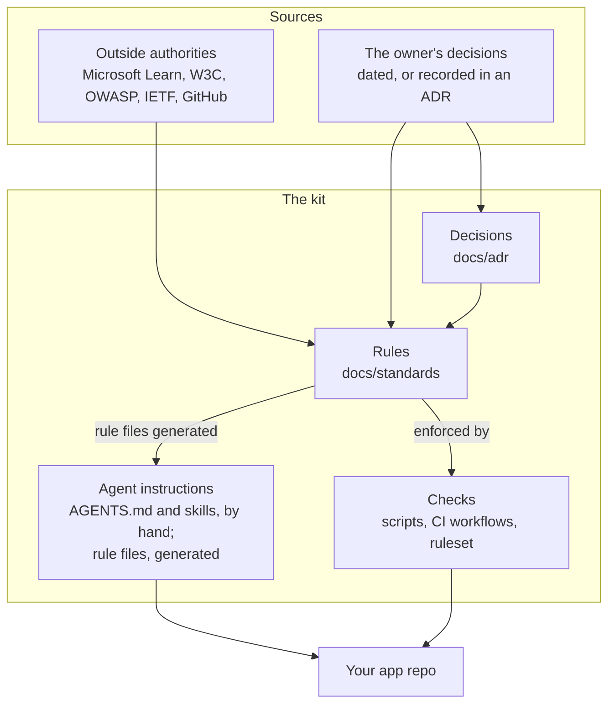
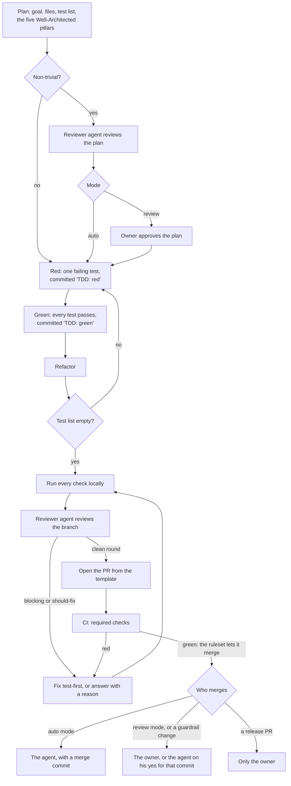
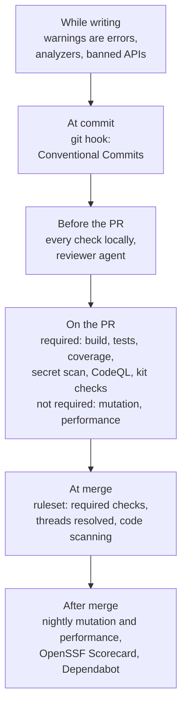
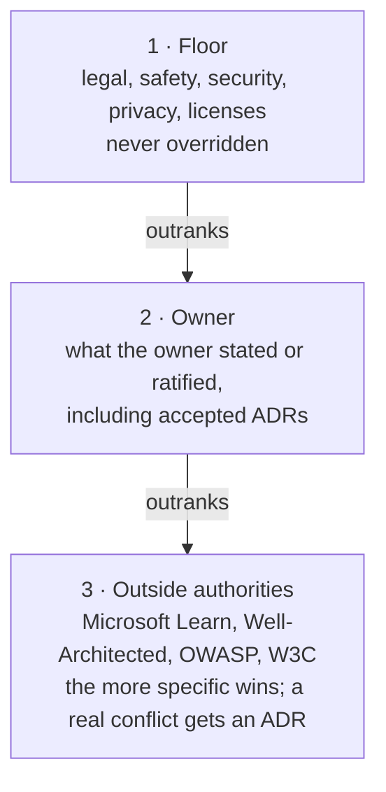
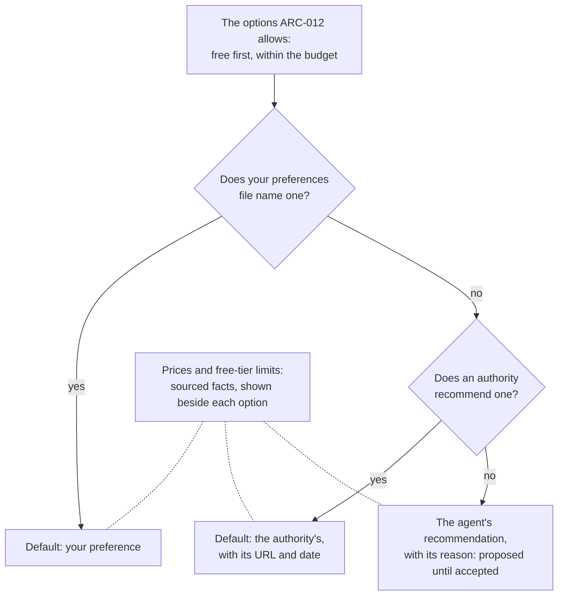

# dotnet-agent-kit

A versioned engineering method for .NET apps built with coding agents. It gives a repo rules that each say where they come from and how they're enforced, checks that run on your machine, in CI and on GitHub, and instructions and skills for the agent, so every change meets the same bar whichever agent, or person, makes it.

Work in progress (v0.1, not yet released).

This repo is public so its CI, and the CI of any public app that uses it, runs free (ADR-0031). It isn't licensed for reuse: all rights reserved. A few files are based on the .NET projects' MIT-licensed work, and the rules quote short passages from Microsoft Learn, the W3C, OWASP and others; their notices, with each quoted work's title, author, source and license, are in `THIRD-PARTY-NOTICES.md` (ADR-0094).

**On this page:** [What it is](#what-it-is) · [Who it's for](#who-its-for) · [Why use it](#why-use-it) · [How a task flows](#how-a-task-flows) · [Where mistakes are caught](#where-mistakes-are-caught) · [Whose rules win](#whose-rules-win) · [Three sources of a recommendation](#three-sources-of-a-recommendation) · [Learn more](#learn-more) · then the reference, from [Set up a machine](#set-up-a-machine) on.

## What it is

A coding agent is fast, and it forgets. Told to write the test first, it may write the code first when the context gets long; told to run the checks, it may report "done" without them. The kit doesn't rely on the agent remembering. Each rule it gives a repo has three parts:

- **A rule** with a source. Every rule in `docs/standards/` names where it comes from: a page by an outside authority such as Microsoft Learn, cited by URL and date, or a decision of the repo's owner, by date or by ADR (an Architecture Decision Record in `docs/adr/`: one page per significant choice, with the options and why one won).
- **An enforcement.** Each rule says how it's checked: by a **gate**, a tool that fails the change, or as **advisory**, checked by a reviewer. The gates in CI and on GitHub run whether or not the agent remembers them; the same scripts run on your machine first, to catch a problem before it's pushed.
- **Instructions for the agent.** `AGENTS.md` and the workflow skills, written by hand, plus rule files generated from the rules, tell each supported tool the same thing: Claude Code, and GitHub Copilot in Visual Studio, VS Code and on GitHub.



It also creates app repos: `New-KitApp` makes a GitHub repo with the kit's build files, agent files, checks, settings and ruleset, from the answers to a short intake (app type, data, database, sign-in, hosting, test tools and a monthly budget). Each new kit release is designed to reach the app as one pull request; that isn't exercised yet, since the kit has no release ([Keep an app current](#keep-an-app-current)).

## Who it's for

- **A .NET developer who works with a coding agent**, and wants the agent's work held to the bar they'd hold their own: test-first, zero warnings, reviewed, with every choice traceable.
- **Apps built as one deployable app**: a web API, a Blazor app, a MAUI or desktop app, with modules that can become services later (ARC-001).
- **On GitHub, with PowerShell 7.6 and the .NET SDK**: the checks are PowerShell scripts and GitHub Actions workflows, and the merge rules are a GitHub ruleset.

It started as its owner's own method, and its rules still carry his choices: see [Three sources of a recommendation](#three-sources-of-a-recommendation) for how that is changing. Until it has a license, you may read it but not reuse it.

## Why use it

- **An agent can't quietly skip a step.** CI fails a branch whose test-first commit isn't followed by one that makes it pass, a build with one warning, a rule with no source, or a generated file someone edited by hand; and the ruleset won't merge anything until CI is green. Before that, a git hook rejects a commit subject that isn't a [Conventional Commit](https://www.conventionalcommits.org/) (a subject such as `fix: reject empty titles`). None of that depends on the agent remembering its instructions.
- **Every rule says where it comes from.** A reader can tell a rule Microsoft's docs set from one that is the owner's choice, and [`docs/authorities.md`](docs/authorities.md) lists every source the rules cite, by publisher.
- **Every choice is written down.** A significant choice gets an ADR with at least two options and a recommendation, and a check makes sure each has its sections.
- **One bar for every agent.** The rule files are generated from the same rules for each agent, so changing to another agent doesn't change the rules.
- **It's versioned.** An app pins a kit release. Dependabot (GitHub's bot that proposes dependency updates) moves the pin, and the kit's sync workflow adds the release's other files to the same pull request, so each release would arrive as one reviewable change; that's designed and tested, but not yet exercised, since the kit has no release.

## How a task flows

Every task runs through the same steps, in order (`AGENTS.md`, "How to work"). The skills in `.claude/skills/` walk the agent through them.



- **Plan.** The goal, the files it touches and a **test list**: the behaviors to cover. The plan covers the five pillars of the [Azure Well-Architected Framework](https://learn.microsoft.com/azure/well-architected/) (reliability, security, cost, operational excellence, performance), plus accessibility, data and docs.
- **Red, green, refactor.** One item from the test list becomes a failing test, committed with `TDD: red` as a trailer (a `Key: value` line at the end of the commit message, which git can read back); the change that makes the whole suite pass is committed with `TDD: green`. CI checks the order.
- **Review.** A read-only reviewer agent (`.claude/agents/reviewer.md`, ADR-0067) that hasn't seen the work reviews the branch against `docs/code-review.md`. Reviews end at the first round with nothing blocking or should-fix.
- **Merge.** GitHub's ruleset on `main` holds the merge until the required checks pass, and allows merge commits only. Who merges depends on the **working mode** (ADR-0035): in **auto**, the default, the agent merges its own PR once CI passes and the review is clean; in **review**, the owner approves plans and merges. A change to the **guardrails**, the files and settings that hold these limits (such as the working modes, the permission rules, the review instructions, a ruleset or a weakened check; `AGENTS.md`, "Working modes", has the full list), needs the owner's yes in either mode, and releases are always the owner's. See [Working modes](#working-modes).

## Where mistakes are caught

Each kind of mistake has a place where a tool stops it, as early as it can be seen. What no tool can check, such as a misleading doc or a weak design, is the reviewer agent's and the owner's.



- **CodeQL** is GitHub's code scanning: it looks for security bugs in the code and the workflows.
- **Mutation testing** breaks the code on purpose, one small change at a time, and checks that a test fails each time.
- **OpenSSF Scorecard** scores the repo's supply-chain practices, such as pinned actions and branch protection, from 0 to 10.
- **Push protection** is GitHub's block on a push that contains a known kind of secret.

| Who | Does | Example |
|---|---|---|
| **The owner** (the developer who owns the repo: the kit's owner, for the kit; you, for your app) | Decides: accepts ADRs and rules, picks the working mode, says yes to guardrail changes and spending, merges releases. Signs in; no agent handles credentials | Approves an ADR choosing the database |
| **The agent** | Plans, writes each test first, runs the checks, opens the PR, answers each review finding with evidence, and merges its own PR in auto mode | Commits a failing test for "reject an empty title", then the fix |
| **The reviewer agent** | Reviews each non-trivial plan, and each branch before its PR opens, read-only, against `docs/code-review.md`; ranks each finding Blocking, Should fix or Consider | Finds a test that would pass even if the code were wrong |
| **Your machine** | The build (warnings as errors, analyzers), the commit hook, and every check script, run before pushing | Rejects the commit subject "fixed stuff" |
| **CI** (GitHub Actions) | Runs every gate on every pull request: build, tests, coverage, secret scan, CodeQL, rule sources, generated files, red-to-green order | Fails a branch where a rule has no source |
| **GitHub** | The "main protection" ruleset holds the merge until CI passes, blocks direct and force pushes to `main`; push protection, Dependabot alerts and security updates | Refuses to merge a PR whose secret scan failed |

## Whose rules win

When two rules disagree, the higher layer wins. This is a summary; `AGENTS.md`, "Whose rules win", is the source. Each rule's `layer` field says which layer it belongs to.



A rule's `basis` says why it exists, which is a separate question from its layer:

| `basis` | Means | Must cite | Example |
|---|---|---|---|
| `authority` | An outside authority sets it | Its page, by URL and the date it was read | API errors use problem details, as RFC 9457 defines them |
| `preference` | The owner chose it | The owner and the date, or the ADR he accepted | Merge with a merge commit, not squash |

Who counts as an authority is ADR-0063's call: Microsoft, standards bodies (the W3C, OWASP, OpenSSF, the IETF) and the vendors of the tools the kit uses. A person's book or blog (Martin Fowler, Robert C. Martin) can back the owner's choice, but a rule resting on one alone is a preference. Two checks hold the form of this in CI:

- `tools/Test-RuleSources.ps1` fails a rule with no source, an `authority` rule that cites no URL, and a `preference` rule that cites neither the owner nor an ADR (ADR-0063).
- `tools/Build-AuthoritiesPage.ps1 -Check` fails a cited page whose publisher isn't classed, an `authority` rule that cites no page from an authority or a tool's own vendor (ADR-0073), and a stale [`docs/authorities.md`](docs/authorities.md), the generated list of every source the rules cite, by publisher. It also fails a stored quote whose work has no license in `docs/authorities.yml`, and a stale quotes block in `THIRD-PARTY-NOTICES.md`, which credits each quoted work (ADR-0094).

Whether a rule says only what its source says is still a reviewer's question: no tool reads the pages.

## Three sources of a recommendation

**Built for the new-app intake; the rules come next.** The owner decided this on 2026-11-15 (`docs/corrections-log.md`), because the kit is meant for other developers as well as for him. The new-app intake labels every default this way (ADR-0074), and a check fails when one has no labeled source. Each developer's preferences live in their own file, `~/.dotnet-agent-kit/preferences.json`, outside every repo (`docs/preferences.md`). The kit's rules don't label their recommendations this way yet.

When an agent recommends something, such as a database, a test library or a hosting plan, the recommendation comes from one of three sources, and the agent says which:

| Source | What it may say | How it's labeled |
|---|---|---|
| **An authority** | Only what its page says: a pick only where the page recommends it, not where it just uses a tool or gives an example | The page's URL and the date it was read |
| **Your own preference** | Whatever you've chosen for your own work | "Your preference", from your own preferences file. It's yours alone, kept out of the kit's rules, so it never reaches another developer as if it were guidance |
| **The agent** | Its own judgment, when neither of the others decides | "The agent's", with its reason. It stays proposed until you accept it |

Among the options a rule allows, the default comes from your preference first, then the authority's, then the agent's. An authority's pick that's Paid is shown but not made the default. ARC-012 still sets the limits: the industry-standard option while it's free for the app, within the app's monthly budget ($0 unless the intake set one), and spending money needs the owner's OK. Prices and free-tier limits are facts with a source (a URL and a date), separate from all three.



Done: ADR-0074, with the per-developer preferences file and the new-app intake labeling each recommendation by its source. Planned next: a rule for it, then a pass over the kit's own `preference` rules, row by row, to keep those that are the kit's method (with their ADRs) and move the owner's personal taste to his own preferences file. Until then, a `preference` rule is the owner's choice, as the `basis` table above says.

## Learn more

| To read | Where |
|---|---|
| Every rule, by topic, with its source and enforcement | [`docs/standards/`](docs/standards/) |
| Every source the rules cite, by publisher | [`docs/authorities.md`](docs/authorities.md) |
| Every significant decision | [`docs/adr/`](docs/adr/) |
| What a "perfect" .NET app is, area by area, and the open gaps | [`docs/quality/scorecard.md`](docs/quality/scorecard.md) |
| What the reviewer agent checks | [`docs/code-review.md`](docs/code-review.md) |
| The agent's instructions, and the commands it runs | [`AGENTS.md`](AGENTS.md) |
| The books and blogs that informed the standards | [`docs/sources.md`](docs/sources.md) |

The rest of this page is reference: setting up a machine, the standards and the agent files, CI, and creating and updating app repos.

## Set up a machine

`tools/Initialize-DevMachine.ps1` checks the whole toolchain and, only when you pass `-Install`, installs what's missing, one tool at a time.

| Tool | Needed for | Required now |
|---|---|---|
| PowerShell 7.6 or later (the current LTS) | Every kit script, and CI | Yes |
| Pester 6 | The kit's script tests | Yes |
| Pester's signed files unchanged (Windows) | Trusting a test run: twice an agent's "restore" of a script, after a test run in a shared session changed its path variable, overwrote one (ADR-0092) | Yes |
| powershell-yaml | Reading rule metadata in `docs/standards` | Yes |
| Git | Everything | Yes |
| GitHub CLI, signed in | Pushing, PRs and reviews | Yes |
| .NET SDK named in `global.json` | Building | Yes |
| Claude Code | Agent sessions | Yes |
| Git commit-msg hook (this clone) | Rejecting non-Conventional commit subjects before they're committed (ADR-0027) | Yes |
| VS Code + PowerShell extension | Running scripts yourself (ISE Mode, D11) | Later |
| Docker | Testcontainers in the sample solution | Later |

**On a new machine**, Git and GitHub CLI come first: you clone, push and open PRs with them. In Windows PowerShell:

```powershell
winget install --id Git.Git --exact
winget install --id GitHub.cli --exact
```

Open a new PowerShell window so both are on PATH, then sign in to GitHub and clone the repo. Sign-in is always yours to do; no script handles credentials.

```powershell
gh auth login
gh repo clone DerekFoulk/dotnet-agent-kit "$env:USERPROFILE\source\repos\DerekFoulk\dotnet-agent-kit"
cd "$env:USERPROFILE\source\repos\DerekFoulk\dotnet-agent-kit"
```

Then let the script install the rest. It runs in Windows PowerShell 5.1 as well, so it can install PowerShell 7.6 for you, or upgrade an older one:

```powershell
powershell -ExecutionPolicy Bypass -File .\tools\Initialize-DevMachine.ps1 -Install
```

Add `-WhatIf` first if you want to see the install commands without running them. When the installs finish, open a new PowerShell 7.6 window (`pwsh`) and run the check again until every line says `[ok]`:

```powershell
./tools/Initialize-DevMachine.ps1
```

The exit code is 0 when every required tool is ready and 1 otherwise, so agents and CI can use it as a gate.

## Standards and decisions

- **`docs/standards/`**: one file per topic. Each rule sits in the file's YAML front matter with its `id`, `statement`, `why`, `layer` (floor, owner or outside), `basis` (authority: an outside source sets it, cited by URL; or preference: the owner's own choice), `status` (accepted or retired), `strength` (must, should or consider, from the source's own words; ADR-0090), `when` (the conditions about the app it holds under, from `conditions.yml`), `sources` and `enforcement`: a list of parts, each a `gate` (a tool fails the change) or `advisory` (a person, an agent or code review checks it), in the kit, in apps or both (ADR-0063). An authority rule is in force at its page's strength; a rule the kit adds starts at `should`, and only the owner makes one a `must`. A check script that judges an app's code (`Test-CodeShape`, `Test-EmptyProjects`, `Test-SafeMigrations`, `Test-Runbook`, and `Get-UiProject`'s reference check) reports a `should` rule's findings as warnings on the pull request and passes, fails on a `must` rule's, and skips a rule the app's profile rules out, with no code change when a strength moves. Other gates of `should` rules still fail: the kit's own sample tests and CI machinery such as the SBOM; and a `should` rule's build gate names only analyzers a `must` rule already turns on (ADR-0089, ADR-0090).
- **`docs/adr/`**: Architecture Decision Records. ADR numbers match the brief's decision numbers (D8 is ADR-0008). New ones start from `docs/adr/0000-template.md`.
- **`docs/quality/scorecard.md`**: the quality scorecard. It says what a "perfect" .NET app looks like, area by area (architecture, tests, security, API design and the rest), which rules cover each area, how many of them a tool checks, and the open gaps, each with an id a later PR can close (ADR-0034).
- **`docs/authorities.md`** lists every source the rules cite, by publisher; it's generated from the rules and `docs/authorities.yml` (ADR-0073). **`docs/sources.md`** lists practitioner sources. **`docs/corrections-log.md`** records owner corrections and what each became.

Four checks keep these honest. Each exits 0 when clean and 1 otherwise:

```powershell
./tools/Test-RuleSources.ps1          # every rule has a valid source (owner + date, ADR, or URL + retrieval date) and an enforcement
./tools/Build-AuthoritiesPage.ps1 -Check  # every cited page's publisher is classed, every quoted work has its license, and both generated blocks are current (ADR-0073, ADR-0094)
./tools/Test-Scorecard.ps1            # every rule in force has a quality area, and the scorecard's table matches the rules
./tools/Test-AdrSections.ps1          # every ADR has its required sections and at least two options with trade-offs
```

After changing a rule or a scorecard area, run `./tools/Test-Scorecard.ps1 -Update` to rewrite the table, and commit it.

## Agent layer

| File | Read by | Written by |
|---|---|---|
| `AGENTS.md` | Claude Code (through `CLAUDE.md`), the Copilot coding agent. VS Code can read it too, but this repo turns that off (`.vscode/settings.json`) because VS Code already gets the same text from `.github/copilot-instructions.md` | Hand |
| `CLAUDE.md` | Claude Code; imports `AGENTS.md` | Hand |
| `.github/copilot-instructions.md` | Visual Studio, VS Code, Copilot on GitHub | Generated copy of `AGENTS.md` |
| `.claude/rules/*.md` | Claude Code (and VS Code Claude sessions), loaded by path | Generated from `docs/standards` |
| `.github/instructions/*.instructions.md` | Copilot, loaded by `applyTo` | Generated from `docs/standards` |
| `.claude/skills/*/SKILL.md` | Claude Code, Visual Studio, VS Code | Hand; the curated .NET skills are copied unchanged from dotnet/skills by `Update-DotnetSkills.ps1` (`docs/dotnet-skills.md`) |
| `.claude/agents/reviewer.md` | Claude Code: the independent reviewer (DOD-003, ADR-0067) | Hand |
| `docs/code-review.md` | The reviewer agent; Copilot code review too, when the owner asks for one, through the generated `.github/instructions/code-review.instructions.md` | Hand |
| `.claude/settings.json` | Claude Code: permissions | Hand, owner-approved |
| `.agent-mode`, `.claude/settings.local.json` (gitignored) | Every agent; Claude Code | `Set-AgentMode.ps1` ("Working modes") |
| `.mcp.json`, `.vscode/mcp.json` | Claude Code and Visual Studio; VS Code | Hand |

The generated files carry only **accepted** rules. After editing a standard or `AGENTS.md`, regenerate them and commit the result:

```powershell
./tools/Build-AgentRules.ps1          # regenerate
./tools/Build-AgentRules.ps1 -Check   # exit 1 if any generated file is missing, hand-edited or stale
```

Two things need a one-time step per user:
- **Visual Studio:** it loads the instruction files only when an option is ticked. Microsoft's docs place it under Tools > Options > All Settings > GitHub > Copilot > Copilot Chat: "Enable custom instructions to be loaded from .github/copilot-instructions.md files and added to requests".
- **Claude Code:** it asks once before connecting to the Microsoft Learn server in `.mcp.json`. Its permission allow rules apply only after you trust the folder.

### Working modes

Agents work in **auto** mode unless you switch to **review** (ADR-0035):

| | Auto (the default) | Review |
|---|---|---|
| Plans | The agent posts its plan and builds it | You approve each non-trivial plan first |
| Packages | The agent adds one when the kit's sources name it, and says so in the PR | The agent asks you first |
| CI and repo settings | The agent goes ahead, except for removing or weakening a check, changing a ruleset, branch protection or the merge settings, or turning off Dependabot alerts or security updates | The agent asks you first |
| Merging | The agent merges its own PR once CI passes and the reviewer agent's findings are answered, and Dependabot's patch and minor updates of NuGet packages, .NET tools and the SDK (ADR-0041). A PR that changes the guardrails merges on your yes, given in the chat for its head commit; a major, a 0.x package or Actions bump, and a release PR are yours | You merge, or tell the agent to for that PR |
| "Won't fix" on a review finding | The agent decides, and gives the reason | You decide |

In both modes, the agent asks before:
- anything that costs money or uses cloud resources;
- deleting or rewriting anything;
- creating an app repo, or making something public;
- adding a connector, or installing software;
- changing a ruleset, branch protection or merge settings, turning off Dependabot alerts or security updates, or removing or weakening a CI check;
- switching the mode;
- anything else that can't be undone.

It never merges a release PR or publishes a release: releases are yours. Secrets and sign-in stay yours. Claude Code prompts for the common forms of these, and the rest rests on the agent's instructions (`AGENTS.md`, "Always ask").

This is the kit's own "auto mode", not Claude Code's permission mode of the same name, which you set in Claude Code itself.

```powershell
./tools/Set-AgentMode.ps1                # show the mode
./tools/Set-AgentMode.ps1 -Mode Review   # you approve plans and merge PRs
./tools/Set-AgentMode.ps1 -Mode Auto     # back to the default
```

The mode is yours alone. Review mode writes `review` to `.agent-mode`, which every agent reads. It also adds the prompts for merging, packages, repo settings and build or CI files to your `.claude/settings.local.json`, which Claude Code combines with `.claude/settings.json`. Both files are gitignored, and auto mode removes what review mode added. If you'd added one of those same prompts to your local settings yourself, auto mode removes it too. The mode belongs to the checkout, so a new git worktree starts in auto: run the script there too. In an app, the script is `./.kit/tools/Set-AgentMode.ps1 -RepoRoot .`.

## CI

`.github/workflows/ci.yml` runs on every pull request and every push to `main`. It calls three reusable workflows that other repos can call once they adopt the kit:

| Workflow | What it checks |
|---|---|
| `dotnet-ci.reusable.yml` | Locked restore with NuGet audit, a zero-warning build (`-warnaserror`), a format check, tests with coverage (browser and accessibility tests too: for a project that uses Playwright, its Chromium is installed first, ADR-0061), the coverage gate (TST-004), deprecated packages, empty projects (ARC-009), package licenses (each locked package's license against `tools/package-licenses.json` and the repo's `.config/package-licenses.json`, which also marks a repo commercial; SEC-005, ADR-0079), the code shape check (CRF-011) and the duplicate code check (CRF-003, which downloads PMD and needs the runner's Java), then uploads an SBOM (software bill of materials: every package the build ships, with its version and licence) as the `sbom` artifact, in CycloneDX JSON, with test and benchmarks projects left out and build-only packages marked `excluded` (SUP-009, ADR-0055, ADR-0062). An app with MAUI or desktop (UI) projects also builds them on Windows and macOS, and its code shape, duplicate code and SBOM steps run on the Windows leg, since Linux can't evaluate those projects; the tests stay on Linux (ARC-010, ADR-0059). Windows and macOS runners are free on a public repo; a private one pays for them, macOS at a multiple of the Linux rate. It also runs a gitleaks secret scan of every commit HEAD reaches: on a pull request, main's history and the PR's commits (ADR-0024) |
| `codeql.reusable.yml` | CodeQL code scanning of the GitHub Actions workflows, and of the C# once there is some, with no build (ADR-0036). Results go to the repo's Security tab. In the kit, the ruleset's code scanning rule blocks a merge on its results (see "GitHub settings on this repo"), and every public app `New-KitApp` creates gets the same rule |
| `kit-checks.reusable.yml` | All Pester tests, rule sources, the quality scorecard, ADR sections, the architecture diagram (`docs/architecture/modules.md`, ARC-013), generated-file drift, the authorities page (`docs/authorities.md`), and on pull requests the commit subjects and red→green order (the branch's own commits) |
| `pr-title.yml` | The PR title is a Conventional Commit. It also runs when the PR is edited, because the title becomes the merge commit's subject |

Three more workflows act rather than check:

| Workflow | What it does |
|---|---|
| `release.yml` | On every push to `main`, release-please, through `release-please.reusable.yml`, keeps a release PR open with the next version and its notes; merging that PR tags `vX.Y.Z` (ADR-0022). Each release takes the Semantic Versioning number its Conventional Commits earn: before 1.0.0, a `fix` bumps the patch, and a `feat` or a breaking change the minor; from 1.0.0 on, a breaking change bumps the major. 1.0.0 itself is the owner's call: a commit with a `Release-As: 1.0.0` footer, never `release-as` in the config, which every app shares (ADR-0096). Every app runs the same job |
| `dependabot-lockfiles.yml` | On Dependabot's NuGet PRs, refreshes every lock file (Dependabot misses the ones that get a package through a project reference) and pushes them as a `chore(deps)` commit. On its PMD PRs, downloads the new release zip and its signature, checks the signature with gpg against PMD's release key pinned in `.config/pmd`, and pins the zip's SHA-256, which must equal GitHub's digest for it, the same way (ADR-0060) |
| `nuget-trust.yml` | Daily, compares the nuget.org certificates `nuget.config` trusts with the ones nuget.org's service index announces (`tools/Test-NuGetTrustedSigners.ps1`), and opens an issue when they differ, so the kit runs `dotnet nuget trust sync nuget.org` before a restore fails (SUP-012, ADR-0066). On a pull request that changes it or `nuget.config` it only runs the check |

`performance.yml` runs the sample's BenchmarkDotNet benchmarks and its Locust load test through `performance.reusable.yml`, each against the budget beside it, nightly, on demand and on every pull request (TST-009, ADR-0062). Shared runners vary, so it isn't a required check; a red run is a finding to answer before merging, and its `benchmark-results` and `load-test-results` artifacts hold the measured numbers. An app runs the same workflow nightly from `templates/app/.github/workflows/performance.yml`.

`secret-scan.yml` runs the same gitleaks scan through `secret-scan.reusable.yml` on every push to a branch other than `main` and every tag push, because a secret is exposed once it's pushed, pull request or not (ADR-0024). Each push gets its own run, never cancelled, on the ref that holds the commit; it isn't a required check. A red run means the secret is already exposed: rotate it. Both scans run `.github/actions/secret-scan`, which refuses a shallow checkout.

`scorecard.yml` runs OpenSSF Scorecard through `scorecard.reusable.yml` on every push to `main` and weekly (SUP-010, ADR-0056). OpenSSF Scorecard, not to be confused with the kit's quality scorecard, is the OpenSSF's tool that scores a repo's supply-chain practices from 0 to 10, in checks such as pinned actions, token permissions and branch protection. It publishes the kit's score to the OpenSSF API, which anyone can read, and uploads its findings to the Security tab beside CodeQL's. It doesn't run on pull requests, so it isn't a required check.

The release and lock-file workflows push with the workflow's own token, so CI on the PR they create or update waits for approval, and they approve it. If a release or Dependabot PR is ever stuck with no checks reporting, close and reopen it: that runs CI as you. Expect the first CI run on each Dependabot NuGet PR to fail locked restore; the lock-file commit replaces it. Once that commit is on the branch, Dependabot may stop rebasing the PR on its own; comment `@dependabot rebase` on it, and the workflow adds the lock files again.

Each action is pinned by commit SHA, and the gitleaks image by tag and digest in `.config/gitleaks/Dockerfile`. `.github/dependabot.yml` keeps NuGet packages, .NET tools, the actions, the `global.json` SDK pin, PMD (`.config/pmd/pom.xml`), the gitleaks image (ADR-0060) and Locust (`.config/locust`, every package pinned by hash; ADR-0062) current. On a PMD PR, the pin job has checked the zip's signature against PMD's release key (a key change has its own steps in ADR-0060); check the pin commit's hash against the digest on PMD's release page. Dependabot waits 7 days before proposing a version (its own default is 3), and 14 for a NuGet or SDK major (by the first number, as SemVer counts it); security updates, which are on, don't wait, though a PMD update still waits until its zip is 7 days old before its hash is pinned (ADR-0060). In auto mode an agent merges its patch and minor updates of NuGet packages, .NET tools and the SDK; majors, any update of a 0.x package (BenchmarkDotNet is one), Actions bumps, and PMD, gitleaks and Locust updates are the owner's (ADR-0041). The "main protection" ruleset on GitHub requires a pull request and these checks to pass ("dotnet / Build, test and package checks", "dotnet / Secret scan (gitleaks)", "kit / Kit checks", "PR title"). It allows merge commits only, and blocks force-pushes and deletion of `main`. It doesn't require a branch to be up to date with `main` before merging, so the merge result itself isn't re-tested; with merge commits that's a deliberate trade against rebuilding after every merge.

### Using the kit's CI from an app repo

An app repo, public or private, calls the kit's shared workflows. Its CI doesn't use the copy of the checking scripts the app keeps in `.kit/tools/` for local runs (below): the shared workflows fetch the kit's scripts through the `kit-tools` action (`uses: $/.github/actions/kit-tools`), which GitHub downloads at the shared workflow's own commit, so an app pinned to a version runs that version's scripts (`spikes/kit-sharing/README.md`, ADR-0030). The kit is public (ADR-0031), so no access setting or token is involved. Each repo pays for its own CI minutes: a public app's runs are free, while a private app's count against its owner's included Actions usage.

The kit's repo name must stay as it is once an app pins it: GitHub doesn't redirect calls to an action in a renamed repo (and very likely not to its reusable workflows), so every app's CI would fail with "repository not found".

Trust a pin only when a kit release tag points to that SHA. In a public repo, a SHA from someone's fork can also resolve ([GitHub's guidance](https://docs.github.com/en/actions/reference/security/secure-use): "verify it is from the action's repository and not a repository fork"), so check it: `gh api repos/DerekFoulk/dotnet-agent-kit/commits/v0.1.0 --jq .sha` prints the commit the tag points to (ADR-0031).

Pin the kit like any other action (SUP-008): by the full commit SHA of a kit release, with the version in a comment. `v0.1.0` is the first release, once release PR 10 merges; until then there's no tag to pin. Two small caller workflows keep a renamed PR from rebuilding the whole app:

```yaml
# .github/workflows/ci.yml in an app repo: the .NET gates
on:
  pull_request:
  push:
    branches: [main]
permissions:
  contents: read
concurrency:
  group: ci-${{ github.ref }}
  cancel-in-progress: true
jobs:
  dotnet:
    uses: DerekFoulk/dotnet-agent-kit/.github/workflows/dotnet-ci.reusable.yml@<commit SHA> # v0.1.0
    with:
      solution: MyApp.slnx
  codeql:
    if: ${{ !github.event.repository.private }} # code scanning needs a paid licence on a private repo
    permissions:
      contents: read
      security-events: write
    uses: DerekFoulk/dotnet-agent-kit/.github/workflows/codeql.reusable.yml@<commit SHA> # v0.1.0
```

```yaml
# .github/workflows/app-checks.yml in an app repo: also runs when the PR is edited
on:
  pull_request:
    types: [opened, edited, synchronize, reopened]
  push:
    branches: [main]
permissions:
  contents: read
jobs:
  app:
    uses: DerekFoulk/dotnet-agent-kit/.github/workflows/app-checks.reusable.yml@<commit SHA> # v0.1.0
```

| Shared workflow | What it checks in the app |
|---|---|
| `dotnet-ci.reusable.yml` | Restore, build, format, tests with coverage (with Playwright's browser installed first for browser tests), the coverage gate, deprecated packages, empty projects, code shape, duplicate code, the `sbom` artifact, and the secret scan. With MAUI or desktop projects, also a build on Windows and macOS, which runs code shape, duplicate code and the SBOM on Windows (ADR-0059). `solution` is required |
| `codeql.reusable.yml` | CodeQL code scanning of the workflows, and the C# once there is some. Skipped on a private app |
| `secret-scan.reusable.yml` | Not a required check: from the app's `secret-scan.yml`, the gitleaks scan of every push to a branch other than `main` and every tag push (ADR-0024). On a private app each run uses about a minute of the account's Actions allowance ($0.006 a minute beyond it, ADR-0024). An app made before `secret-scan.yml` joined the template adds it by hand ("WorkflowByHand") |
| `scorecard.reusable.yml` | Not a pull request check: OpenSSF Scorecard on `main` and weekly, from the app's `scorecard.yml`, publishing the score. Skipped on a private app, where the action publishes nothing and code scanning needs a paid licence. An app made before `scorecard.yml` joined the template adds it by hand ("WorkflowByHand") |
| `app-checks.reusable.yml` | On pull requests: the PR title, the commit subjects and red→green order. Always: ADR sections, when the app has `docs/adr`, the runbook, `docs/runbook.md` (OPS-004), which fails when it's missing, the architecture diagram, `docs/architecture/modules.md` (ARC-013), which fails when it's missing or empty, and every EF Core migration's `Up`, which mustn't drop or rename what the running version uses without a reason (DAT-003). Called from any other event, it fails rather than pass having checked nothing |
| `release-please.reusable.yml` | Not a check: from the app's `release.yml`, on every push to `main`, release-please keeps the app's release PR open, with the next version its Conventional Commits earn and its notes, and approves that PR's waiting CI runs; merging it tags `vX.Y.Z`, which MinVer builds take their version from. It reads the app's `release-please-config.json` (the kit's, which the sync keeps current) and `.release-please-manifest.json` (the app's own, from `0.0.0`, so the first release is `0.1.0`). An app made before `release.yml` joined the template adds it by hand ("WorkflowByHand"), and turns on "Allow GitHub Actions to create and approve pull requests" in its repo settings (Actions › General › Workflow permissions), which `New-KitApp` sets for new apps; without it, release-please can't open the release PR. On a private app, each push to `main` uses about two minutes of the account's Actions allowance ($0.006 a minute beyond it, ADR-0031) (ADR-0096) |
| `kit-sync.reusable.yml` | Not a check: on Dependabot's kit-pin PR, brings the release's other kit-managed files into it (see "Keep an app current"). Called from anything but Dependabot's own GitHub Actions PR, it fails |

`dotnet-ci.reusable.yml` and `app-checks.reusable.yml` also take an `app-bundle` input, which only the kit's own CI passes: its fresh-app jobs run these workflows on a freshly exported web-api app and blazor app, so a kit change that would break an app's required checks fails the kit first (ADR-0095). An app leaves it out.

The gates assume the app has the kit's build files: `global.json` (SDK pin and the Microsoft Testing Platform runner), `Directory.Build.props` (warnings as errors, analyzers, lock files, NuGet audit), `Directory.Packages.props`, `.editorconfig` (with `THIRD-PARTY-NOTICES.md`, which carries its MIT notices), `.globalconfig`, `CodeMetricsConfig.txt` and `BannedSymbols.txt` (the craft checks, ADR-0043; without them the metric limits and bans do nothing), and a committed `packages.lock.json` per project. Without them, "locked restore" has no lock files to enforce. `New-KitApp` (PR D2) creates them, and the kit sync keeps them current (see "Keep an app current" below).

### Create an app repo's files

`tools/Export-KitApp.ps1` writes a new app's files into an empty folder, taken from the kit at one commit or tag (ADR-0032). `tools/New-KitApp.ps1` calls it and then creates the GitHub repo (see "Start a new app" below).

```powershell
./tools/Export-KitApp.ps1 -Name Contoso.Orders -Destination ../Contoso.Orders -KitRef v0.1.0
```

- The files come from a clean checkout of `-KitRef` (a temporary git worktree), never from your working tree, so an uncommitted edit can't reach an app.
- The app gets the kit's build files, agent files, skills (except the kit-only `new-app` skill), code-review instructions, standards and commit hook unchanged, except that its `.claude/settings.json` leaves out the rules for kit scripts it doesn't get (such as `New-KitApp`); the checking scripts in `.kit/tools/`; the database guide, `docs/database-guide.md`; and its own `AGENTS.md`, `THIRD-PARTY-NOTICES.md`, `README.md`, `<Name>.slnx` (no projects yet), CI and release callers pinned to the kit commit, the kit's `release-please-config.json` and a `.release-please-manifest.json` of its own at `0.0.0` (ADR-0096), a Draft runbook (`docs/runbook.md`) to fill in before its first deployment, and a `.github/dependabot.yml` for its NuGet packages and the kit pin, rendered from `templates/app/`. Its agent rule files are generated during the export.
- `Directory.Packages.props` keeps the kit's build and test packages and drops the ones in the `ItemGroup` labelled `Sample app`.
- `.kit/manifest.json` records the kit version (the release tag on the commit, or `unreleased`) and commit, and the SHA-256 of every file the kit manages, taken over the text with LF line endings so it's the same on every checkout. The kit sync uses it to know what it may replace, and `appName` to export the app again. In `AGENTS.md` and `THIRD-PARTY-NOTICES.md`, only the block between `kit:begin` and `kit:end` is the kit's.
- It refuses a folder that isn't empty, a name that isn't a dotted .NET name (or contains a Windows device name such as `Con`), and a ref that isn't a commit or tag, before writing anything. If it fails partway, it removes what it wrote.

### Start a new app

Ask an agent in the chat for a new app. Its `new-app` skill asks you the intake cards, each with a recommended answer and its cost (Free, Free tier or Paid, with the price): app type, data, database, sign-in, hosting, a monthly budget, and the test tools for each kind of test, free by default (for a commercial app, FluentAssertions 8 is swapped for AwesomeAssertions, ADR-0004). It writes your answers to a file, runs `New-KitApp` with `-WhatIf`, and creates the repo once you say yes. The answers become the app's `docs/app-profile.md`, which its plans start from (ADR-0058). The cards and the test tools live in `templates/app-intake.json`.

`tools/New-KitApp.ps1` creates an app repo on your own GitHub account, with the kit's files, settings and ruleset, using your existing `gh` sign-in (ADR-0033). Try it with `-WhatIf` first: it runs the checks and lists the steps, and changes nothing.

```powershell
./tools/New-KitApp.ps1 -Name Contoso.Orders -Intake ./answers.json -WhatIf
./tools/New-KitApp.ps1 -Name Contoso.Orders -Intake ./answers.json
```

| Parameter | Default |
|---|---|
| `-Intake` | Required: the intake answers, a JSON file the `new-app` skill writes, checked against `templates/app-intake.json` at `-KitRef`. No release has that file yet, so until one does, pass a `-KitRef` from after it was added |
| `-RepoName` | The app name. Set it for a repo name a .NET namespace can't have, such as `contoso-orders` (GitHub allows letters, digits, `-`, `_` and `.`) |
| `-KitRef` | The kit's newest release tag (`vX.Y.Z`). Until one exists, pass a kit commit or tag |
| `-Destination` | A folder named after the repo, next to the kit's folder |
| `-Private` | Off: the repo is public, so its CI runs free on GitHub's standard runners (ADR-0033). Anyone can read a public app's code, history and PRs; with no license, nobody may reuse them. On GitHub Free, rulesets work only on public repos, so a private repo's ruleset may not hold; and whether a public app's holds isn't verified either, since it's added while the repo is still private. `New-KitApp` may then report success while `main` is unprotected, so on a new account, try a direct push to `main` in its first app (ADR-0033) |

The app name (`-Name`) must be a dotted .NET name, because it becomes the solution's name and the root namespace, which can't contain hyphens.

It checks first, before changing anything: the app and repo names, an empty folder, the kit ref (which must have `templates/github` and `templates/app-intake.json`), the intake answers, that `gh` is signed in, and that the repo doesn't exist yet. Then, in order:

1. Exports the files (`Export-KitApp`).
2. Writes the intake answers to `docs/app-profile.md`, which the app owns: the kit sync never changes it.
3. Makes the first commit, `chore: start from dotnet-agent-kit <version>`, with the commit hook stored as executable for Linux and macOS.
4. Creates the repo, private for now, with the kit's merge settings (`templates/github/repo.json`): merge commits only, titled with the PR title and an empty body, branches deleted after merging, no wiki.
5. Lets GitHub Actions create and approve pull requests, so release-please can open the app's release PR with the workflow's own token, and keeps workflow tokens read-only by default (`templates/github/workflow-permissions.json`, ADR-0096). It comes before the push, which starts the first `release.yml` run.
6. Pushes `main`.
7. Adds the "main protection" ruleset (`templates/github/main-protection.json`), after the push so it doesn't reject it. It requires `dotnet / Build, test and package checks`, `dotnet / Secret scan (gitleaks)` and `app / App checks`, and every review thread resolved. It doesn't request Copilot code review: the reviewer agent reviews instead (ADR-0067).
8. Turns on Dependabot alerts and security updates, so a known vulnerability gets its fix PR without waiting for the cooldown (ADR-0041). Turning alerts on also turns on the dependency graph, private repos included.
9. Requires every GitHub Action in a workflow to be pinned to a full commit SHA (`templates/github/actions.json`, SUP-008).
10. Unless `-Private` is set: makes it public only now, so a failure before this leaves a private repo, then turns on secret scanning and push protection, requires approval before any fork's PR runs (`templates/github/public.json`), and adds a "code scanning" ruleset that blocks a merge on a CodeQL error or a high security alert (`templates/github/code-scanning.json`, SEC-006). A private app doesn't run CodeQL, and a rule requiring it would block every merge, so it doesn't get that ruleset. Set "only collaborators can open issues" yourself in the repo's settings; GitHub has no API for it.
11. Turns the commit hook on in the local copy.

If a step fails, it stops and says what's done and what's left, and whether the repo or the folder is kept. It never deletes a repo. Claude Code asks before running it.

### Keep an app current

Each new kit release is designed to reach an app as one pull request, with no stored token (ADR-0044, ADR-0045). The kit has no release yet, so this hasn't run end to end (see "Not verified" below):

1. The app's Dependabot (`.github/dependabot.yml`, its `github-actions` entry) opens a PR that moves the kit pin in the app's workflows to the new release, 7 days after it's out. Every kit reference is in one group, so it's one PR. Dependabot may change workflow files; a workflow's own token can't.
2. On that PR, the app's `.github/workflows/kit-sync.yml` calls `kit-sync.reusable.yml` at the new pin, so the sync that runs is the release's own. It runs only on Dependabot's own GitHub Actions PRs from the app's repo.
3. `tools/Sync-KitApp.ps1` takes the release from the moved pins and refuses one no release tag points to (ADR-0031). It exports the app at its old kit version and at the release, and updates every kit-managed file, the kit blocks of `AGENTS.md` and `THIRD-PARTY-NOTICES.md`, `.claude/settings.json` (made again with the release's tools), the `global.json` SDK pin and `.kit/manifest.json`. The app's own files are never changed, with two exceptions. A package the release adds that the kit's files need (an analyzer, say) is added to the app's `Directory.Packages.props`, in an `ItemGroup` labelled `dotnet-agent-kit`; a package the app removed or re-versioned stays as the app has it. And a file the release is the first to start every app with, for the app to own (such as `docs/runbook.md`), is added when the app lacks it; one the app deleted isn't brought back (ADR-0047).
4. The workflow pushes that as one commit to Dependabot's branch, comments the report on the PR, and approves the CI runs its commit leaves waiting.

A kit-managed file the app edited is merged three ways with the kit's change. If the two overlap, the app's text stays. Either way, the PR comment lists it under "Needs a look", with what to do, along with:

- a kit file the app deleted (it stays deleted);
- a file the kit dropped that the app had edited (it becomes the app's);
- an app file where the kit now adds one (the app's stays);
- a file the release is the first to start every app with, such as `docs/runbook.md`, added because the app lacked it (fill it in);
- an edited generated rule file (rebuilt);
- packages added to `Directory.Packages.props` (refresh the lock files with `dotnet restore --force-evaluate`, since the sync doesn't restore), and any left out because the app lists them in the other form (`PackageVersion` or `GlobalPackageReference`), which NuGet rejects;
- a kit change to a workflow beyond its pin ("WorkflowByHand": apply it on the PR's branch, since the sync never writes `.github/workflows/`). A workflow whose only kit change is the pin, which Dependabot moved, needs nothing.

So an app may add its own lines to `.gitignore`, `global.json` or `.claude/settings.json`, and keep them across releases.

Before merging, check the pin against the release tag: the comment gives the `gh api` command. The sync's own tag check runs code from the pinned commit, so it catches a mistaken pin, not a malicious one; the `gh api` check is the one that counts. Don't merge a kit-pin PR without the sync's comment: kit-sync isn't a required check, so a failed sync doesn't block the merge, and the next GitHub Actions PR from Dependabot would then carry the whole sync. A sync PR is a GitHub Actions bump that usually changes the app's guardrails, so the owner merges it (ADR-0041). Run it by hand from a kit clone with its tags:

```powershell
./tools/Sync-KitApp.ps1 -AppRoot ../Contoso.Orders -KitRoot . -KitRef v0.2.0 -ReportPath ../sync-report.md
```

Not yet:
- applying `templates/github/` settings and rulesets to existing apps, which needs an admin token;
- refreshing lock files after the sync adds a package.

Not verified until the kit has a second release (v0.1.0 isn't tagged yet): that Dependabot proposes it for a SHA pin with its version comment, and that the CI approval works in an app.

### GitHub settings on this repo

Applied 2026-11-06 with the owner's OK, after the repo went public:

| Setting | Value | Why |
|---|---|---|
| Secret scanning, push protection | On | Free on public repos (ADR-0031); gitleaks stays the required check |
| Approval for running fork pull request workflows from contributors | Require approval for all external contributors | A fork's PR runs nothing until the owner approves it (ADR-0031) |
| Issues | Only collaborators can open them (set by the owner in the browser; GitHub documents no API for it) | The repo isn't open for outside contributions |
| Pull requests | Anyone can open them (unchanged) | Left open so Dependabot and release-please keep opening PRs; fork PRs still wait for approval |
| Wiki | Off | Until it's published from the repo (planned after D2a) |
| Dependabot security updates | Off (unchanged); turned on 2026-11-09, see below | Reviewed 2026-11-09: the cooldown on version updates relies on them (ADR-0041) |

Applied 2026-11-09 with the owner's OK:

| Setting | Value | Why |
|---|---|---|
| Actions: require actions pinned to a full-length commit SHA | On | Enforces SUP-008. The shared workflows' `$/.github/actions/kit-tools` resolves to a full SHA, so it passes |
| "main protection" ruleset: require code scanning results | CodeQL; blocks on an alert of severity error, or a security alert high or higher, on lines the pull request changes, or while CodeQL's analysis is in progress or missing | Enforces SEC-006 at merge time; CodeQL runs on every pull request |
| "main protection" ruleset: require conversation resolution | On | Every review thread is resolved before merging; that each one was answered with evidence (DOD-005) is still the agents' job |
| Dependabot alerts and security updates | On | A known vulnerability gets its fix PR at once, without the 7- and 14-day wait version updates have (ADR-0041); New-KitApp turns both on for every app |

Applied 2026-11-12 with the owner's OK, and removed 2026-11-14 on his yes:

| Setting | Value | Why |
|---|---|---|
| "main protection" ruleset: automatically request Copilot code review | Off: the rule is removed | From 2026-11-12 it asked Copilot for a review of each PR and each push to it (ADR-0064). Each used the owner's GitHub AI credits, and they ran out; the reviewer agent reviews instead (ADR-0067) |

## Run the tests

```powershell
./tools/Invoke-KitTests.ps1
```

`tools/Invoke-KitTests.ps1` runs Pester in a child `pwsh -NoProfile` process, from the repo root, with `$ErrorActionPreference` set to `Stop` as in CI, and returns the counts; `-Path` and `-FullNameFilter` narrow the run. Don't run `Invoke-Pester` in a session you keep using: a Pester run can change that session's variables (ADR-0092).

`tools/tests/BuildConfig.Tests.ps1` copies the root build config (`global.json`, `Directory.*.props`, `.editorconfig`, `nuget.config`, `.globalconfig`, `CodeMetricsConfig.txt`, `BannedSymbols.txt`, `BannedSymbols.Pure.txt`) into isolated workspaces and builds small fixture projects against it. It proves that clean code builds with a MinVer version and a lock file, and that `var`, nullable violations, `latest-all` analyzer findings, the rules `latest-all` leaves off, the metric limits and the banned APIs fail the build, while code at each metric limit builds (ADR-0043). It also checks that every banned symbol exists and that CRF-008 states the limits `CodeMetricsConfig.txt` sets.
