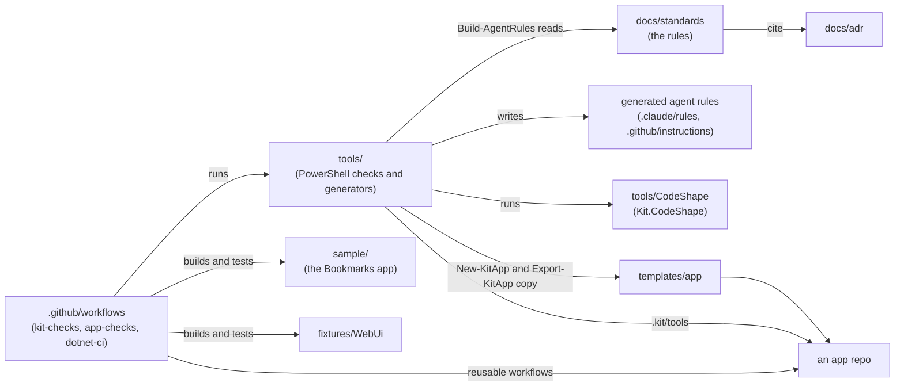
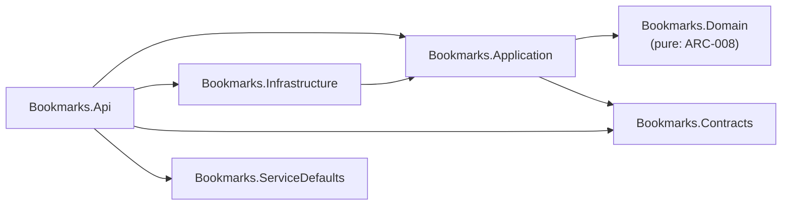

# The kit's parts and how they depend on each other

ARC-013 asks every repo to keep a diagram of its modules and their dependencies here, and `tools/Test-ArchitectureDiagram.ps1` checks that it's there. Keeping it current is code review's job: a change that adds a part, or a dependency between parts, updates the diagram in the same PR.

## The kit

## The sample's layers

The sample is one ARC-001 module. Each arrow is a project reference; `sample/tests/Bookmarks.Architecture.Tests` fails if a layer depends outward.

