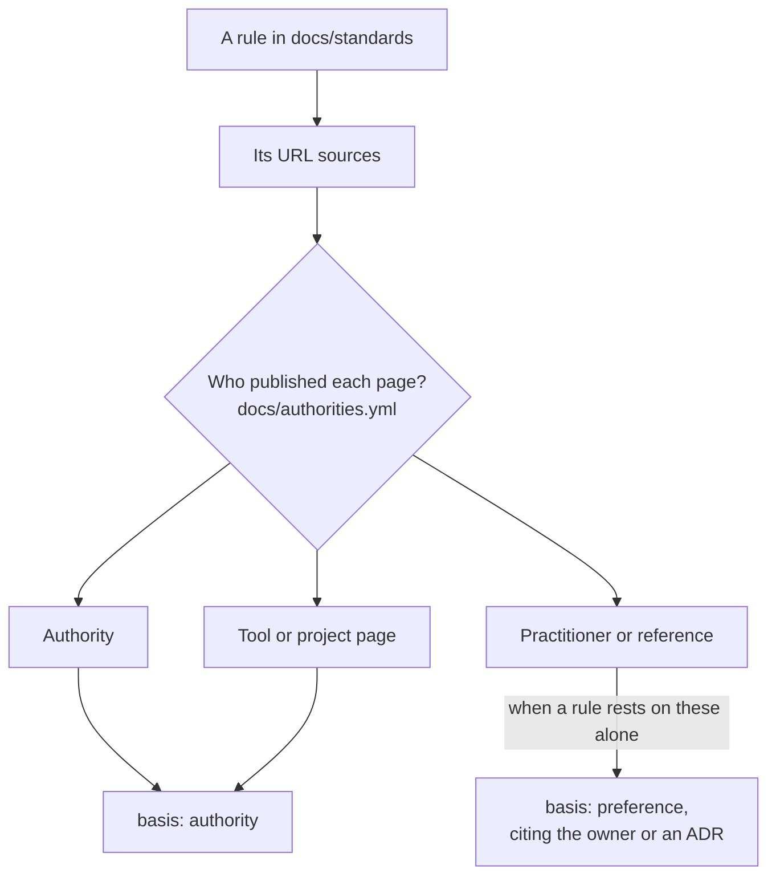

# Who the rules' sources are

Every rule in [`docs/standards/`](standards/) cites where it comes from (ADR-0063). This page lists every page those rules cite, grouped by who published it, with what each source covers and which rules cite it. It's generated from the rules themselves, so it can't fall behind them (ADR-0073).

## Three kinds of source

| Kind | Who | What a rule resting on it is |
|---|---|---|
| **Authority** | The body that makes the product or sets the standard: Microsoft documenting .NET and Azure, GitHub documenting GitHub, and standards bodies such as the W3C, the IETF and OWASP | `basis: authority`. The rule says what the authority's page says, cited by URL and the date it was read |
| **Tool or project page** | A tool's own repo or docs, from the vendor of a tool the kit uses, such as Deque's axe-core | An authority too, but only for how to use that tool (ADR-0063), so it's listed apart |
| **Practitioner or reference** | A person, a book or a reference work: Martin Fowler, Robert C. Martin, *The Pragmatic Programmer*, Wikipedia | Ideas the owner chose to adopt. A rule resting on these alone is a `preference`, cited by the owner or an ADR |

A source is classed by its publisher, not by the site it's on: github.com hosts Microsoft's `dotnet/runtime`, OWASP's ASVS and Deque's axe-core alike, and an archived copy on web.archive.org is classed as the page it archives. Some pages are cited two ways (a Microsoft Learn page with and without `/en-us/`, or with a `#fragment`); each is listed once.

This page isn't [`docs/sources.md`](sources.md). That one is a reading list: the books and blogs read when a standard was written, whether or not a rule cites them.

## What the check enforces

`tools/Build-AuthoritiesPage.ps1 -Check` runs in the kit's CI. It fails when:

- a rule cites a page whose publisher `docs/authorities.yml` doesn't list;
- an entry in `docs/authorities.yml` matches no page the rules cite, or is missing a field;
- a rule with `basis: authority` cites no page from an authority or a tool or project page (ADR-0063);
- the block below is out of date.

When a rule cites a new publisher, add an entry to [`docs/authorities.yml`](authorities.yml), with its name, publisher, kind, what it covers and the URL prefixes of its pages; then run `./tools/Build-AuthoritiesPage.ps1` and commit this page. Rules that are `proposed` aren't in force yet: they're listed, marked "(proposed)". Retired rules are left out.

## Every source

<!-- sources from docs/standards: generated by Build-AuthoritiesPage.ps1 from docs/authorities.yml; edit those, not this block (ADR-0073) -->
The rules cite 137 pages from 16 sources; 76 rules cite them.

### Authorities

| Source | Publisher | Covers | Cited by |
|---|---|---|---|
| [.NET's own repositories](#nets-own-repositories) | Microsoft (the .NET team) | the .NET runtime's code style (.editorconfig) | [STY-001](standards/code-style.md), [STY-002](standards/code-style.md) |
| [Aspire documentation](#aspire-documentation) | Microsoft (the Aspire team) | Aspire's service defaults and health checks | [OPS-002](standards/operations.md) |
| [GitHub Docs](#github-docs) | GitHub | code scanning with CodeQL, secret scanning and push protection | [SEC-001](standards/security.md), [SEC-006](standards/security.md) |
| [Microsoft Learn](#microsoft-learn) | Microsoft | .NET, C#, ASP.NET Core, Blazor, EF Core, MAUI, NuGet, Azure and the Well-Architected Framework, Entra ID, SQL Server, Visual Studio | [API-001](standards/api-design.md) (proposed), [API-002](standards/api-design.md), [API-003](standards/api-design.md), [API-004](standards/api-design.md), [API-005](standards/api-design.md) (proposed), [API-006](standards/api-design.md) (proposed), [API-007](standards/api-design.md), [ARC-001](standards/architecture.md), [ARC-002](standards/architecture.md), [ARC-003](standards/architecture.md), [ARC-004](standards/architecture.md), [ARC-005](standards/architecture.md), [ARC-008](standards/architecture.md), [ARC-009](standards/architecture.md) (proposed), [ARC-010](standards/architecture.md) (proposed), [ARC-012](standards/architecture.md), [ARC-013](standards/architecture.md), [CRF-003](standards/craft.md), [CRF-005](standards/craft.md), [CRF-006](standards/craft.md), [CRF-008](standards/craft.md), [CRF-009](standards/craft.md), [CRF-010](standards/craft.md), [CRF-013](standards/craft.md), [CRF-014](standards/craft.md), [DAT-001](standards/data.md) (proposed), [DAT-002](standards/data.md) (proposed), [DAT-003](standards/data.md) (proposed), [DAT-004](standards/data.md) (proposed), [DAT-005](standards/data.md) (proposed), [DAT-006](standards/data.md) (proposed), [DAT-007](standards/data.md), [DAT-008](standards/data.md), [DAT-009](standards/data.md), [DAT-010](standards/data.md), [OPS-001](standards/operations.md), [OPS-002](standards/operations.md), [OPS-003](standards/operations.md), [OPS-004](standards/operations.md) (proposed), [OPS-005](standards/operations.md), [OPS-006](standards/operations.md), [OPS-007](standards/operations.md), [SEC-007](standards/security.md) (proposed), [SEC-008](standards/security.md) (proposed), [SEC-009](standards/security.md) (proposed), [SEC-010](standards/security.md) (proposed), [SEC-011](standards/security.md), [SEC-014](standards/security.md), [SEC-015](standards/security.md), [STY-003](standards/code-style.md), [STY-005](standards/code-style.md), [STY-007](standards/code-style.md), [STY-008](standards/code-style.md), [STY-009](standards/code-style.md), [STY-010](standards/code-style.md), [STY-011](standards/code-style.md), [SUP-001](standards/supply-chain.md), [SUP-003](standards/supply-chain.md), [SUP-004](standards/supply-chain.md), [SUP-007](standards/supply-chain.md), [SUP-009](standards/supply-chain.md) (proposed), [SUP-011](standards/supply-chain.md) (proposed), [SUP-012](standards/supply-chain.md), [TST-004](standards/testing.md), [TST-010](standards/testing.md), [UI-001](standards/ui.md) (proposed), [UI-002](standards/ui.md) (proposed) |
| [OWASP](#owasp) | OWASP Foundation (Open Worldwide Application Security Project) | input validation, secrets management, API authorization, and the Application Security Verification Standard (ASVS) 5.0 | [CRF-006](standards/craft.md), [DAT-010](standards/data.md), [SEC-001](standards/security.md), [SEC-007](standards/security.md) (proposed), [SEC-008](standards/security.md) (proposed), [SEC-009](standards/security.md) (proposed), [SEC-010](standards/security.md) (proposed), [SEC-011](standards/security.md), [SEC-012](standards/security.md), [SEC-013](standards/security.md) |
| [RFC Editor](#rfc-editor) | IETF (Internet Engineering Task Force) | HTTP problem details for API errors (RFC 9457) | [API-002](standards/api-design.md) |
| [Web Content Accessibility Guidelines (WCAG) 2.2](#web-content-accessibility-guidelines-wcag-22) | W3C (World Wide Web Consortium) | accessibility of web and app user interfaces, and WCAG2ICT for apps that aren't on the web | [UI-001](standards/ui.md) (proposed), [UI-002](standards/ui.md) (proposed) |

### Tool and project pages

| Source | Publisher | Covers | Cited by |
|---|---|---|---|
| [axe-core](#axe-core) | Deque Systems | the axe accessibility engine and its Playwright package for .NET | [UI-002](standards/ui.md) (proposed) |
| [CycloneDX for .NET](#cyclonedx-for-net) | OWASP CycloneDX | the SBOM tool the kit's CI runs | [SUP-009](standards/supply-chain.md) (proposed) |
| [OpenSSF Scorecard action](#openssf-scorecard-action) | OpenSSF (Open Source Security Foundation) | the Scorecard GitHub Action and its workflow limits | [SUP-010](standards/supply-chain.md) (proposed) |

### Practitioners and references

| Source | Publisher | Covers | Cited by |
|---|---|---|---|
| [Diátaxis](#diátaxis) | Daniele Procida | the four kinds of documentation (tutorial, how-to, reference, explanation) | [OPS-004](standards/operations.md) (proposed) |
| [From STUPID to SOLID Code!](#from-stupid-to-solid-code) | William Durand | the STUPID anti-patterns | [CRF-009](standards/craft.md) |
| [Martin Fowler's site](#martin-fowlers-site) | Martin Fowler | YAGNI and evolutionary design | [CRF-004](standards/craft.md) |
| [Principles of OOD, archived](#principles-of-ood-archived) | Robert C. Martin | SOLID and the package principles | [CRF-005](standards/craft.md), [CRF-007](standards/craft.md) |
| [The Pragmatic Programmer, tips](#the-pragmatic-programmer-tips) | Andrew Hunt and David Thomas | DRY (don't repeat yourself) | [CRF-003](standards/craft.md) |
| [Wikipedia](#wikipedia) | Wikipedia contributors | summaries of Robert C. Martin's SOLID and acyclic dependencies principles, and Barbara Liskov's substitution principle | [CRF-005](standards/craft.md), [CRF-007](standards/craft.md) |

### Pages cited

#### .NET's own repositories

| Page | Cited by |
|---|---|
| <https://github.com/dotnet/runtime/blob/860eddba936f4a7e8a04cb12ee3bc54385216cab/.editorconfig> | [STY-001](standards/code-style.md), [STY-002](standards/code-style.md) |

#### Aspire documentation

| Page | Cited by |
|---|---|
| <https://aspire.dev/fundamentals/health-checks/> | [OPS-002](standards/operations.md) |

#### GitHub Docs

| Page | Cited by |
|---|---|
| <https://docs.github.com/en/code-security/concepts/code-scanning/codeql/codeql-code-scanning> | [SEC-006](standards/security.md) |
| <https://docs.github.com/en/code-security/concepts/secret-security/push-protection> | [SEC-001](standards/security.md) |
| <https://docs.github.com/en/code-security/concepts/secret-security/secret-scanning> | [SEC-001](standards/security.md) |

#### Microsoft Learn

| Page | Cited by |
|---|---|
| <https://learn.microsoft.com/aspnet/core/blazor/fundamentals/routing> | [UI-001](standards/ui.md) (proposed) |
| <https://learn.microsoft.com/aspnet/core/blazor/test?view=aspnetcore-10.0> | [UI-002](standards/ui.md) (proposed) |
| <https://learn.microsoft.com/aspnet/core/fundamentals/apis> | [API-001](standards/api-design.md) (proposed) |
| <https://learn.microsoft.com/aspnet/core/fundamentals/best-practices> | [OPS-007](standards/operations.md) |
| <https://learn.microsoft.com/aspnet/core/fundamentals/error-handling-api> | [API-002](standards/api-design.md) |
| <https://learn.microsoft.com/aspnet/core/fundamentals/minimal-apis> | [API-006](standards/api-design.md) (proposed), [CRF-013](standards/craft.md) |
| <https://learn.microsoft.com/aspnet/core/fundamentals/minimal-apis/security> | [SEC-008](standards/security.md) (proposed) |
| <https://learn.microsoft.com/aspnet/core/fundamentals/openapi/overview> | [API-003](standards/api-design.md) |
| <https://learn.microsoft.com/aspnet/core/fundamentals/openapi/using-openapi-documents> | [API-003](standards/api-design.md) |
| <https://learn.microsoft.com/aspnet/core/fundamentals/servers/kestrel/security-considerations> | [SEC-011](standards/security.md) |
| <https://learn.microsoft.com/aspnet/core/fundamentals/validation> | [API-006](standards/api-design.md) (proposed), [SEC-010](standards/security.md) (proposed) |
| <https://learn.microsoft.com/aspnet/core/grpc/comparison> | [API-001](standards/api-design.md) (proposed) |
| <https://learn.microsoft.com/aspnet/core/host-and-deploy/health-checks> | [OPS-002](standards/operations.md) |
| <https://learn.microsoft.com/aspnet/core/security/authentication/configure-jwt-bearer-authentication> | [SEC-008](standards/security.md) (proposed) |
| <https://learn.microsoft.com/aspnet/core/security/authentication/jwt-authn> | [SEC-008](standards/security.md) (proposed) |
| <https://learn.microsoft.com/aspnet/core/security/authorization/policies> | [SEC-007](standards/security.md) (proposed) |
| <https://learn.microsoft.com/aspnet/core/security/authorization/secure-data> | [SEC-007](standards/security.md) (proposed) |
| <https://learn.microsoft.com/aspnet/core/security/data-protection/introduction> | [SEC-015](standards/security.md) |
| <https://learn.microsoft.com/aspnet/core/signalr/introduction> | [API-001](standards/api-design.md) (proposed) |
| <https://learn.microsoft.com/azure/aks/zero-downtime-migration> | [DAT-003](standards/data.md) (proposed) |
| <https://learn.microsoft.com/azure/architecture/best-practices/api-design> | [API-004](standards/api-design.md), [API-005](standards/api-design.md) (proposed), [API-007](standards/api-design.md) |
| <https://learn.microsoft.com/azure/architecture/best-practices/api-implementation> | [API-004](standards/api-design.md), [API-007](standards/api-design.md) |
| <https://learn.microsoft.com/azure/architecture/guide/technology-choices/data-store-decision-tree> | [DAT-001](standards/data.md) (proposed) |
| <https://learn.microsoft.com/azure/architecture/microservices/design/api-design> | [API-005](standards/api-design.md) (proposed) |
| <https://learn.microsoft.com/azure/azure-sql/database/free-offer> | [DAT-006](standards/data.md) (proposed) |
| <https://learn.microsoft.com/azure/cloud-adoption-framework/manage/ready-cloud-operations> | [OPS-004](standards/operations.md) (proposed) |
| <https://learn.microsoft.com/azure/cosmos-db/emulator-linux> | [DAT-005](standards/data.md) (proposed) |
| <https://learn.microsoft.com/azure/cosmos-db/free-tier> | [DAT-006](standards/data.md) (proposed) |
| <https://learn.microsoft.com/azure/cosmos-db/limit-total-account-throughput> | [DAT-006](standards/data.md) (proposed) |
| <https://learn.microsoft.com/azure/cost-management-billing/costs/tutorial-acm-create-budgets> | [DAT-006](standards/data.md) (proposed) |
| <https://learn.microsoft.com/azure/well-architected/architect-role/fundamentals> | [ARC-005](standards/architecture.md), [ARC-013](standards/architecture.md), [SUP-007](standards/supply-chain.md) |
| <https://learn.microsoft.com/azure/well-architected/cost-optimization/principles> | [ARC-012](standards/architecture.md) |
| <https://learn.microsoft.com/azure/well-architected/operational-excellence/formalize-operations-tasks> | [OPS-004](standards/operations.md) (proposed) |
| <https://learn.microsoft.com/azure/well-architected/operational-excellence/incident-response> | [OPS-004](standards/operations.md) (proposed) |
| <https://learn.microsoft.com/azure/well-architected/operational-excellence/safe-deployments> | [DAT-003](standards/data.md) (proposed), [OPS-004](standards/operations.md) (proposed) |
| <https://learn.microsoft.com/azure/well-architected/reliability/simplify> | [ARC-004](standards/architecture.md), [ARC-009](standards/architecture.md) (proposed) |
| <https://learn.microsoft.com/dotnet/architecture/maui/mvvm> | [ARC-003](standards/architecture.md), [ARC-010](standards/architecture.md) (proposed) |
| <https://learn.microsoft.com/dotnet/architecture/microservices/architect-microservice-container-applications/data-sovereignty-per-microservice> | [ARC-002](standards/architecture.md) |
| <https://learn.microsoft.com/dotnet/architecture/microservices/microservice-ddd-cqrs-patterns/ddd-oriented-microservice> | [ARC-009](standards/architecture.md) (proposed) |
| <https://learn.microsoft.com/dotnet/architecture/microservices/microservice-ddd-cqrs-patterns/eshoponcontainers-cqrs-ddd-microservice> | [ARC-009](standards/architecture.md) (proposed) |
| <https://learn.microsoft.com/dotnet/architecture/modern-web-apps-azure/architectural-principles> | [CRF-003](standards/craft.md), [CRF-005](standards/craft.md), [CRF-006](standards/craft.md), [CRF-009](standards/craft.md), [CRF-014](standards/craft.md) |
| <https://learn.microsoft.com/dotnet/architecture/modern-web-apps-azure/common-web-application-architectures> | [ARC-001](standards/architecture.md), [ARC-009](standards/architecture.md) (proposed) |
| <https://learn.microsoft.com/dotnet/core/diagnostics/observability-with-otel> | [OPS-001](standards/operations.md) |
| <https://learn.microsoft.com/dotnet/core/extensions/best-practices-for-developing-world-ready-apps> | [ARC-008](standards/architecture.md) |
| <https://learn.microsoft.com/dotnet/core/extensions/dependency-injection/guidelines> | [CRF-009](standards/craft.md), [CRF-013](standards/craft.md) |
| <https://learn.microsoft.com/dotnet/core/extensions/generic-host> | [OPS-005](standards/operations.md) |
| <https://learn.microsoft.com/dotnet/core/extensions/logging/high-performance-logging> | [OPS-007](standards/operations.md) |
| <https://learn.microsoft.com/dotnet/core/extensions/options> | [OPS-006](standards/operations.md) |
| <https://learn.microsoft.com/dotnet/core/project-sdk/msbuild-props> | [STY-003](standards/code-style.md) |
| <https://learn.microsoft.com/dotnet/core/resilience/http-resilience> | [OPS-003](standards/operations.md) |
| <https://learn.microsoft.com/dotnet/core/testing/unit-testing-best-practices> | [TST-004](standards/testing.md), [TST-010](standards/testing.md) |
| <https://learn.microsoft.com/dotnet/core/tools/dotnet-workload-sets> | [SUP-011](standards/supply-chain.md) (proposed) |
| <https://learn.microsoft.com/dotnet/core/tools/nuget-signed-package-verification> | [SUP-012](standards/supply-chain.md) |
| <https://learn.microsoft.com/dotnet/csharp/asynchronous-programming/async-scenarios> | [STY-011](standards/code-style.md) |
| <https://learn.microsoft.com/dotnet/csharp/fundamentals/coding-style/coding-conventions> | [STY-007](standards/code-style.md), [STY-008](standards/code-style.md) |
| <https://learn.microsoft.com/dotnet/csharp/fundamentals/coding-style/identifier-names> | [STY-007](standards/code-style.md) |
| <https://learn.microsoft.com/dotnet/csharp/language-reference/xmldoc/> | [STY-008](standards/code-style.md) |
| <https://learn.microsoft.com/dotnet/csharp/language-reference/xmldoc/recommended-tags> | [STY-008](standards/code-style.md) |
| <https://learn.microsoft.com/dotnet/csharp/nullable-references> | [STY-005](standards/code-style.md) |
| <https://learn.microsoft.com/dotnet/fundamentals/code-analysis/code-quality-rule-options> | [STY-009](standards/code-style.md) |
| <https://learn.microsoft.com/dotnet/fundamentals/code-analysis/quality-rules/ca1506> | [CRF-008](standards/craft.md) |
| <https://learn.microsoft.com/dotnet/fundamentals/code-analysis/quality-rules/security-warnings> | [SEC-014](standards/security.md) |
| <https://learn.microsoft.com/dotnet/fundamentals/code-analysis/style-rules/naming-rules> | [STY-007](standards/code-style.md) |
| <https://learn.microsoft.com/dotnet/fundamentals/networking/http/httpclient-guidelines> | [OPS-003](standards/operations.md) |
| <https://learn.microsoft.com/dotnet/maui/fundamentals/accessibility> | [UI-001](standards/ui.md) (proposed) |
| <https://learn.microsoft.com/dotnet/standard/asynchronous-programming-patterns/consuming-the-task-based-asynchronous-pattern> | [STY-011](standards/code-style.md) |
| <https://learn.microsoft.com/dotnet/standard/asynchronous-programming-patterns/task-based-asynchronous-pattern-tap> | [STY-007](standards/code-style.md) |
| <https://learn.microsoft.com/dotnet/standard/base-types/best-practices-regex> | [STY-003](standards/code-style.md) |
| <https://learn.microsoft.com/dotnet/standard/collections/thread-safe/> | [STY-009](standards/code-style.md) |
| <https://learn.microsoft.com/dotnet/standard/datetime/choosing-between-datetime> | [ARC-008](standards/architecture.md) |
| <https://learn.microsoft.com/dotnet/standard/design-guidelines/> | [STY-009](standards/code-style.md), [STY-010](standards/code-style.md) |
| <https://learn.microsoft.com/dotnet/standard/design-guidelines/event> | [STY-010](standards/code-style.md) |
| <https://learn.microsoft.com/dotnet/standard/design-guidelines/exception-throwing> | [STY-010](standards/code-style.md) |
| <https://learn.microsoft.com/dotnet/standard/design-guidelines/exceptions-and-performance> | [STY-010](standards/code-style.md) |
| <https://learn.microsoft.com/dotnet/standard/design-guidelines/general-naming-conventions> | [STY-010](standards/code-style.md) |
| <https://learn.microsoft.com/dotnet/standard/design-guidelines/guidelines-for-collections> | [STY-010](standards/code-style.md) |
| <https://learn.microsoft.com/dotnet/standard/design-guidelines/operator-overloads> | [STY-010](standards/code-style.md) |
| <https://learn.microsoft.com/dotnet/standard/design-guidelines/parameter-design> | [STY-010](standards/code-style.md) |
| <https://learn.microsoft.com/dotnet/standard/design-guidelines/property> | [STY-010](standards/code-style.md) |
| <https://learn.microsoft.com/dotnet/standard/native-interop/best-practices> | [STY-003](standards/code-style.md) |
| <https://learn.microsoft.com/dotnet/standard/security/cryptography-model> | [SEC-015](standards/security.md) |
| <https://learn.microsoft.com/dotnet/standard/security/secure-coding-guidelines> | [SEC-014](standards/security.md) |
| <https://learn.microsoft.com/dotnet/standard/security/security-and-user-input> | [SEC-015](standards/security.md) |
| <https://learn.microsoft.com/dotnet/standard/security/vulnerabilities-cbc-mode> | [SEC-014](standards/security.md), [SEC-015](standards/security.md) |
| <https://learn.microsoft.com/dotnet/standard/serialization/binaryformatter-security-guide> | [SEC-014](standards/security.md) |
| <https://learn.microsoft.com/dotnet/standard/threading/managed-threading-best-practices> | [STY-007](standards/code-style.md) |
| <https://learn.microsoft.com/dotnet/standard/unsafe-code/best-practices> | [CRF-010](standards/craft.md) |
| <https://learn.microsoft.com/ef/core/managing-schemas/ensure-created> | [DAT-002](standards/data.md) (proposed) |
| <https://learn.microsoft.com/ef/core/managing-schemas/migrations/> | [DAT-002](standards/data.md) (proposed) |
| <https://learn.microsoft.com/ef/core/managing-schemas/migrations/applying> | [DAT-004](standards/data.md) (proposed) |
| <https://learn.microsoft.com/ef/core/managing-schemas/migrations/managing> | [DAT-003](standards/data.md) (proposed) |
| <https://learn.microsoft.com/ef/core/miscellaneous/connection-resiliency> | [DAT-007](standards/data.md) |
| <https://learn.microsoft.com/ef/core/performance/> | [DAT-009](standards/data.md) |
| <https://learn.microsoft.com/ef/core/performance/efficient-querying> | [DAT-009](standards/data.md) |
| <https://learn.microsoft.com/ef/core/querying/sql-queries> | [DAT-010](standards/data.md) |
| <https://learn.microsoft.com/ef/core/querying/tracking> | [DAT-009](standards/data.md) |
| <https://learn.microsoft.com/ef/core/saving/concurrency> | [DAT-008](standards/data.md) |
| <https://learn.microsoft.com/ef/core/testing/choosing-a-testing-strategy> | [DAT-005](standards/data.md) (proposed) |
| <https://learn.microsoft.com/ef/core/testing/testing-with-the-database> | [DAT-005](standards/data.md) (proposed) |
| <https://learn.microsoft.com/entra/identity-platform/id-token-claims-reference> | [SEC-009](standards/security.md) (proposed) |
| <https://learn.microsoft.com/nuget/concepts/security-best-practices> | [SUP-001](standards/supply-chain.md), [SUP-003](standards/supply-chain.md), [SUP-004](standards/supply-chain.md), [SUP-012](standards/supply-chain.md) |
| <https://learn.microsoft.com/nuget/consume-packages/installing-signed-packages> | [SUP-012](standards/supply-chain.md) |
| <https://learn.microsoft.com/nuget/reference/nuget-config-file> | [SUP-012](standards/supply-chain.md) |
| <https://learn.microsoft.com/security/benchmark/azure/mcsb-v2-devops-security> | [SUP-009](standards/supply-chain.md) (proposed) |
| <https://learn.microsoft.com/sql/connect/ado-net/sql/compare-guid-uniqueidentifier-values> | [API-004](standards/api-design.md) |
| <https://learn.microsoft.com/visualstudio/code-quality/code-metrics-cyclomatic-complexity> | [CRF-008](standards/craft.md) |

#### OWASP

| Page | Cited by |
|---|---|
| <https://api-security.owasp.org/editions/2023/en/0xa1-broken-object-level-authorization> | [SEC-009](standards/security.md) (proposed) |
| <https://api-security.owasp.org/editions/2023/en/0xa3-broken-object-property-level-authorization> | [SEC-013](standards/security.md) |
| <https://api-security.owasp.org/editions/2023/en/0xa4-unrestricted-resource-consumption> | [SEC-011](standards/security.md) |
| <https://cheatsheetseries.owasp.org/cheatsheets/Input_Validation_Cheat_Sheet.html> | [CRF-006](standards/craft.md) |
| <https://cheatsheetseries.owasp.org/cheatsheets/Secrets_Management_Cheat_Sheet.html> | [SEC-001](standards/security.md) |
| <https://cheatsheetseries.owasp.org/cheatsheets/SQL_Injection_Prevention_Cheat_Sheet.html> | [DAT-010](standards/data.md) |
| <https://github.com/OWASP/ASVS/blob/v5.0.0/5.0/en/0x11-V2-Validation-and-Business-Logic.md> | [SEC-010](standards/security.md) (proposed) |
| <https://github.com/OWASP/ASVS/blob/v5.0.0/5.0/en/0x17-V8-Authorization.md> | [SEC-007](standards/security.md) (proposed), [SEC-009](standards/security.md) (proposed) |
| <https://github.com/OWASP/ASVS/blob/v5.0.0/5.0/en/0x18-V9-Self-contained-Tokens.md> | [SEC-008](standards/security.md) (proposed) |
| <https://github.com/OWASP/ASVS/tree/v5.0.0> | [SEC-012](standards/security.md) |

#### RFC Editor

| Page | Cited by |
|---|---|
| <https://www.rfc-editor.org/rfc/rfc9457> | [API-002](standards/api-design.md) |

#### Web Content Accessibility Guidelines (WCAG) 2.2

| Page | Cited by |
|---|---|
| <https://www.w3.org/TR/WCAG22/> | [UI-001](standards/ui.md) (proposed), [UI-002](standards/ui.md) (proposed) |
| <https://www.w3.org/TR/wcag2ict-22/> | [UI-001](standards/ui.md) (proposed) |

#### axe-core

| Page | Cited by |
|---|---|
| <https://github.com/dequelabs/axe-core-nuget/blob/develop/packages/playwright/README.md> | [UI-002](standards/ui.md) (proposed) |
| <https://github.com/dequelabs/axe-core/blob/develop/doc/API.md> | [UI-002](standards/ui.md) (proposed) |

#### CycloneDX for .NET

| Page | Cited by |
|---|---|
| <https://github.com/CycloneDX/cyclonedx-dotnet> | [SUP-009](standards/supply-chain.md) (proposed) |

#### OpenSSF Scorecard action

| Page | Cited by |
|---|---|
| <https://github.com/ossf/scorecard-action> | [SUP-010](standards/supply-chain.md) (proposed) |

#### Diátaxis

| Page | Cited by |
|---|---|
| <https://diataxis.fr/how-to-guides/> | [OPS-004](standards/operations.md) (proposed) |

#### From STUPID to SOLID Code!

| Page | Cited by |
|---|---|
| <https://williamdurand.fr/2013/07/30/from-stupid-to-solid-code/> | [CRF-009](standards/craft.md) |

#### Martin Fowler's site

| Page | Cited by |
|---|---|
| <https://martinfowler.com/articles/designDead.html> | [CRF-004](standards/craft.md) |
| <https://martinfowler.com/bliki/Yagni.html> | [CRF-004](standards/craft.md) |

#### Principles of OOD, archived

| Page | Cited by |
|---|---|
| <https://web.archive.org/web/20220121055640/http://butunclebob.com/ArticleS.UncleBob.PrinciplesOfOod> | [CRF-005](standards/craft.md), [CRF-007](standards/craft.md) |

#### The Pragmatic Programmer, tips

| Page | Cited by |
|---|---|
| <https://pragprog.com/tips/> | [CRF-003](standards/craft.md) |

#### Wikipedia

| Page | Cited by |
|---|---|
| <https://en.wikipedia.org/wiki/Acyclic_dependencies_principle> | [CRF-007](standards/craft.md) |
| <https://en.wikipedia.org/wiki/Liskov_substitution_principle> | [CRF-005](standards/craft.md) |
| <https://en.wikipedia.org/wiki/SOLID> | [CRF-005](standards/craft.md) |
<!-- end sources -->
