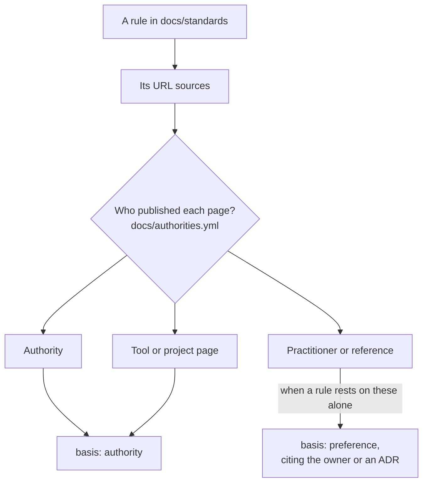

# Who the rules' sources are

Every rule in [`docs/standards/`](standards/) cites where it comes from (ADR-0063). This page lists every page those rules cite, grouped by who published it, with what each source covers and which rules cite it. It's generated from the rules themselves, so it can't fall behind them (ADR-0073).

## Three kinds of source

| Kind | Who | What a rule resting on it is |
|---|---|---|
| **Authority** | The body that makes the product or sets the standard: Microsoft documenting .NET and Azure, GitHub documenting GitHub, and standards bodies such as the W3C, the IETF and OWASP | `basis: authority`. The rule says what the authority's page says, cited by URL and the date it was read |
| **Tool or project page** | A tool's own repo or docs, from the vendor of a tool the kit uses, such as Deque's axe-core | An authority too, but only for how to use that tool (ADR-0063), so it's listed apart |
| **Practitioner or reference** | A person, a book or a reference work: Martin Fowler, Robert C. Martin, *The Pragmatic Programmer*, Wikipedia | Ideas the owner chose to adopt. A rule resting on these alone is a `preference`, cited by the owner or an ADR |

A source is classed by its publisher, not by the site it's on: github.com hosts Microsoft's `dotnet/runtime`, OWASP's ASVS and Deque's axe-core alike, and an archived copy on web.archive.org is classed as the page it archives. Some pages are cited two ways (a Microsoft Learn page with and without `/en-us/`, or with a `#fragment`); each is listed once.

This page isn't [`docs/sources.md`](sources.md). That one is a reading list: the books and blogs read when a standard was written, whether or not a rule cites them.

## What the check enforces

`tools/Build-AuthoritiesPage.ps1 -Check` runs in the kit's CI. It fails when:

- a rule cites a page whose publisher `docs/authorities.yml` doesn't list;
- an entry in `docs/authorities.yml` matches no page the rules cite, or is missing a field;
- a rule with `basis: authority` cites no page from an authority or a tool or project page (ADR-0063);
- the block below is out of date.

When a rule cites a new publisher, add an entry to [`docs/authorities.yml`](authorities.yml), with its name, publisher, kind, what it covers and the URL prefixes of its pages; then run `./tools/Build-AuthoritiesPage.ps1` and commit this page. Rules that are `proposed` aren't in force yet: they're listed, marked "(proposed)". Retired rules are left out.

## Every source

<!-- sources from docs/standards: generated by Build-AuthoritiesPage.ps1 from docs/authorities.yml; edit those, not this block (ADR-0073) -->
The rules cite 283 pages from 16 sources; 215 rules cite them.

### Authorities

| Source | Publisher | Covers | Cited by |
|---|---|---|---|
| [.NET's own repositories](#nets-own-repositories) | Microsoft (the .NET team) | the .NET runtime's code style (.editorconfig) | [STY-001](standards/code-style.md), [STY-002](standards/code-style.md) |
| [Aspire documentation](#aspire-documentation) | Microsoft (the Aspire team) | Aspire's service defaults and health checks | [OPS-002](standards/operations.md), [OPS-017](standards/operations.md) (proposed) |
| [GitHub Docs](#github-docs) | GitHub | code scanning with CodeQL, secret scanning and push protection | [SEC-016](standards/security.md) |
| [Microsoft Learn](#microsoft-learn) | Microsoft | .NET, C#, ASP.NET Core, Blazor, EF Core, MAUI, NuGet, Azure and the Well-Architected Framework, Entra ID, SQL Server, Visual Studio | [API-002](standards/api-design.md), [API-003](standards/api-design.md), [API-004](standards/api-design.md), [API-005](standards/api-design.md) (proposed), [API-006](standards/api-design.md) (proposed), [API-007](standards/api-design.md), [API-008](standards/api-design.md) (proposed), [API-009](standards/api-design.md), [API-010](standards/api-design.md), [API-011](standards/api-design.md), [API-012](standards/api-design.md) (proposed), [ARC-001](standards/architecture.md), [ARC-002](standards/architecture.md), [ARC-004](standards/architecture.md), [ARC-008](standards/architecture.md), [ARC-010](standards/architecture.md) (proposed), [ARC-012](standards/architecture.md), [ARC-013](standards/architecture.md), [ARC-014](standards/architecture.md) (proposed), [ARC-015](standards/architecture.md), [ARC-016](standards/architecture.md) (proposed), [ARC-017](standards/architecture.md) (proposed), [ARC-018](standards/architecture.md), [ARC-019](standards/architecture.md) (proposed), [ASP-001](standards/aspnetcore.md) (proposed), [ASP-002](standards/aspnetcore.md) (proposed), [ASP-003](standards/aspnetcore.md) (proposed), [ASP-004](standards/aspnetcore.md) (proposed), [ASP-005](standards/aspnetcore.md) (proposed), [ASP-006](standards/aspnetcore.md) (proposed), [ASP-007](standards/aspnetcore.md) (proposed), [ASP-008](standards/aspnetcore.md) (proposed), [ASP-009](standards/aspnetcore.md) (proposed), [ASP-010](standards/aspnetcore.md) (proposed), [ASP-011](standards/aspnetcore.md) (proposed), [ASP-012](standards/aspnetcore.md) (proposed), [ASP-015](standards/aspnetcore.md) (proposed), [ASP-016](standards/aspnetcore.md) (proposed), [ASP-017](standards/aspnetcore.md) (proposed), [ASP-018](standards/aspnetcore.md) (proposed), [ASP-019](standards/aspnetcore.md) (proposed), [ASP-020](standards/aspnetcore.md) (proposed), [ASP-021](standards/aspnetcore.md) (proposed), [ASP-023](standards/aspnetcore.md) (proposed), [ASP-024](standards/aspnetcore.md) (proposed), [BLZ-001](standards/blazor.md) (proposed), [BLZ-002](standards/blazor.md) (proposed), [BLZ-003](standards/blazor.md) (proposed), [BLZ-004](standards/blazor.md) (proposed), [BLZ-005](standards/blazor.md) (proposed), [BLZ-006](standards/blazor.md) (proposed), [BLZ-007](standards/blazor.md) (proposed), [BLZ-008](standards/blazor.md) (proposed), [BLZ-009](standards/blazor.md) (proposed), [BLZ-010](standards/blazor.md) (proposed), [BLZ-011](standards/blazor.md) (proposed), [BLZ-012](standards/blazor.md) (proposed), [BLZ-013](standards/blazor.md) (proposed), [BLZ-014](standards/blazor.md) (proposed), [BLZ-015](standards/blazor.md) (proposed), [BLZ-016](standards/blazor.md) (proposed), [BLZ-017](standards/blazor.md) (proposed), [BLZ-018](standards/blazor.md) (proposed), [BLZ-019](standards/blazor.md) (proposed), [BLZ-020](standards/blazor.md) (proposed), [BLZ-021](standards/blazor.md) (proposed), [BLZ-022](standards/blazor.md) (proposed), [BLZ-023](standards/blazor.md) (proposed), [BLZ-024](standards/blazor.md) (proposed), [BLZ-025](standards/blazor.md) (proposed), [BLZ-026](standards/blazor.md) (proposed), [CRF-003](standards/craft.md), [CRF-005](standards/craft.md), [CRF-006](standards/craft.md), [CRF-008](standards/craft.md), [CRF-009](standards/craft.md), [CRF-010](standards/craft.md), [CRF-013](standards/craft.md), [CRF-014](standards/craft.md), [CRF-015](standards/craft.md), [CRF-016](standards/craft.md), [CRF-017](standards/craft.md), [CRF-019](standards/craft.md), [CRF-020](standards/craft.md), [CS-001](standards/csharp.md) (proposed), [CS-002](standards/csharp.md) (proposed), [CS-003](standards/csharp.md) (proposed), [CS-004](standards/csharp.md) (proposed), [CS-005](standards/csharp.md) (proposed), [CS-006](standards/csharp.md) (proposed), [CS-007](standards/csharp.md) (proposed), [CS-008](standards/csharp.md) (proposed), [CS-009](standards/csharp.md) (proposed), [CS-010](standards/csharp.md) (proposed), [CS-011](standards/csharp.md) (proposed), [CS-012](standards/csharp.md) (proposed), [CS-013](standards/csharp.md) (proposed), [CS-014](standards/csharp.md) (proposed), [CS-015](standards/csharp.md) (proposed), [CS-016](standards/csharp.md) (proposed), [CS-017](standards/csharp.md) (proposed), [CS-018](standards/csharp.md) (proposed), [CS-019](standards/csharp.md) (proposed), [CS-020](standards/csharp.md) (proposed), [CS-021](standards/csharp.md) (proposed), [CS-022](standards/csharp.md) (proposed), [CS-023](standards/csharp.md) (proposed), [CS-024](standards/csharp.md) (proposed), [CS-025](standards/csharp.md) (proposed), [CS-026](standards/csharp.md) (proposed), [CS-027](standards/csharp.md) (proposed), [CS-028](standards/csharp.md) (proposed), [CS-029](standards/csharp.md) (proposed), [CS-030](standards/csharp.md) (proposed), [CS-031](standards/csharp.md) (proposed), [CS-032](standards/csharp.md) (proposed), [CS-033](standards/csharp.md) (proposed), [CS-034](standards/csharp.md) (proposed), [CS-035](standards/csharp.md) (proposed), [CS-036](standards/csharp.md) (proposed), [CS-038](standards/csharp.md) (proposed), [CS-039](standards/csharp.md) (proposed), [DAT-001](standards/data.md) (proposed), [DAT-005](standards/data.md) (proposed), [DAT-006](standards/data.md) (proposed), [DAT-009](standards/data.md), [DAT-010](standards/data.md), [DAT-011](standards/data.md) (proposed), [DAT-012](standards/data.md) (proposed), [DAT-013](standards/data.md) (proposed), [DAT-014](standards/data.md) (proposed), [DAT-015](standards/data.md), [DAT-016](standards/data.md), [DAT-017](standards/data.md) (proposed), [DAT-018](standards/data.md) (proposed), [DAT-019](standards/data.md) (proposed), [DAT-020](standards/data.md) (proposed), [DAT-021](standards/data.md) (proposed), [DAT-022](standards/data.md) (proposed), [DAT-023](standards/data.md) (proposed), [DAT-024](standards/data.md) (proposed), [HST-001](standards/hosting.md) (proposed), [HST-002](standards/hosting.md) (proposed), [HST-003](standards/hosting.md) (proposed), [HST-004](standards/hosting.md) (proposed), [HST-005](standards/hosting.md) (proposed), [MAU-001](standards/maui.md) (proposed), [MAU-002](standards/maui.md) (proposed), [MAU-004](standards/maui.md) (proposed), [MAU-005](standards/maui.md) (proposed), [MAU-006](standards/maui.md) (proposed), [MAU-007](standards/maui.md) (proposed), [MAU-008](standards/maui.md) (proposed), [MAU-009](standards/maui.md) (proposed), [MAU-010](standards/maui.md) (proposed), [MAU-011](standards/maui.md) (proposed), [MAU-012](standards/maui.md) (proposed), [MAU-013](standards/maui.md) (proposed), [MAU-014](standards/maui.md) (proposed), [MAU-015](standards/maui.md) (proposed), [MAU-016](standards/maui.md) (proposed), [NET-002](standards/dotnet.md) (proposed), [OPS-001](standards/operations.md), [OPS-002](standards/operations.md), [OPS-003](standards/operations.md), [OPS-004](standards/operations.md) (proposed), [OPS-005](standards/operations.md), [OPS-006](standards/operations.md), [OPS-007](standards/operations.md), [OPS-008](standards/operations.md), [OPS-009](standards/operations.md), [OPS-010](standards/operations.md), [OPS-011](standards/operations.md), [OPS-012](standards/operations.md) (proposed), [OPS-013](standards/operations.md) (proposed), [OPS-015](standards/operations.md) (proposed), [OPS-016](standards/operations.md) (proposed), [SEC-017](standards/security.md) (proposed), [SEC-018](standards/security.md) (proposed), [SEC-019](standards/security.md) (proposed), [SEC-021](standards/security.md), [SEC-024](standards/security.md), [SEC-025](standards/security.md), [STY-003](standards/code-style.md), [STY-007](standards/code-style.md), [STY-009](standards/code-style.md), [STY-010](standards/code-style.md), [STY-012](standards/code-style.md), [STY-013](standards/code-style.md), [STY-014](standards/code-style.md), [STY-017](standards/code-style.md), [STY-018](standards/code-style.md), [SUP-013](standards/supply-chain.md), [SUP-014](standards/supply-chain.md), [SUP-015](standards/supply-chain.md), [SUP-016](standards/supply-chain.md) (proposed), [SUP-018](standards/supply-chain.md), [TST-004](standards/testing.md), [TST-010](standards/testing.md), [TST-012](standards/testing.md) (proposed), [UI-001](standards/ui.md) (proposed), [UI-002](standards/ui.md) (proposed), [UI-003](standards/ui.md) (proposed), [UI-004](standards/ui.md) (proposed) |
| [OWASP](#owasp) | OWASP Foundation (Open Worldwide Application Security Project) | input validation, secrets management, API authorization, and the Application Security Verification Standard (ASVS) 5.0 | [CRF-006](standards/craft.md), [CRF-018](standards/craft.md), [DAT-010](standards/data.md), [SEC-016](standards/security.md), [SEC-017](standards/security.md) (proposed), [SEC-018](standards/security.md) (proposed), [SEC-019](standards/security.md) (proposed), [SEC-020](standards/security.md) (proposed), [SEC-021](standards/security.md), [SEC-022](standards/security.md), [SEC-023](standards/security.md) |
| [RFC Editor](#rfc-editor) | IETF (Internet Engineering Task Force) | HTTP problem details for API errors (RFC 9457) | [API-002](standards/api-design.md) |
| [Web Content Accessibility Guidelines (WCAG) 2.2](#web-content-accessibility-guidelines-wcag-22) | W3C (World Wide Web Consortium) | accessibility of web and app user interfaces, and WCAG2ICT for apps that aren't on the web | [UI-001](standards/ui.md) (proposed), [UI-002](standards/ui.md) (proposed), [UI-003](standards/ui.md) (proposed) |

### Tool and project pages

| Source | Publisher | Covers | Cited by |
|---|---|---|---|
| [axe-core](#axe-core) | Deque Systems | the axe accessibility engine and its Playwright package for .NET | [UI-002](standards/ui.md) (proposed) |
| [Microsoft's threading analyzers](#microsofts-threading-analyzers) | Microsoft (the vs-threading team) | the Microsoft.VisualStudio.Threading.Analyzers rules the kit turns on | [STY-017](standards/code-style.md) |
| [OpenSSF Scorecard action](#openssf-scorecard-action) | OpenSSF (Open Source Security Foundation) | the Scorecard GitHub Action and its workflow limits | [SUP-017](standards/supply-chain.md) (proposed) |

### Practitioners and references

| Source | Publisher | Covers | Cited by |
|---|---|---|---|
| [Diátaxis](#diátaxis) | Daniele Procida | the four kinds of documentation (tutorial, how-to, reference, explanation) | [OPS-004](standards/operations.md) (proposed) |
| [From STUPID to SOLID Code!](#from-stupid-to-solid-code) | William Durand | the STUPID anti-patterns | [CRF-009](standards/craft.md) |
| [Martin Fowler's site](#martin-fowlers-site) | Martin Fowler | YAGNI and evolutionary design | [CRF-004](standards/craft.md) |
| [Principles of OOD, archived](#principles-of-ood-archived) | Robert C. Martin | SOLID and the package principles | [CRF-005](standards/craft.md), [CRF-007](standards/craft.md) |
| [The Pragmatic Programmer, tips](#the-pragmatic-programmer-tips) | Andrew Hunt and David Thomas | DRY (don't repeat yourself) | [CRF-003](standards/craft.md) |
| [Wikipedia](#wikipedia) | Wikipedia contributors | summaries of Robert C. Martin's SOLID and acyclic dependencies principles, and Barbara Liskov's substitution principle | [CRF-005](standards/craft.md), [CRF-007](standards/craft.md) |

### Pages cited

#### .NET's own repositories

| Page | Cited by |
|---|---|
| <https://github.com/dotnet/runtime/blob/860eddba936f4a7e8a04cb12ee3bc54385216cab/.editorconfig> | [STY-001](standards/code-style.md), [STY-002](standards/code-style.md) |

#### Aspire documentation

| Page | Cited by |
|---|---|
| <https://aspire.dev/fundamentals/health-checks/> | [OPS-002](standards/operations.md), [OPS-017](standards/operations.md) (proposed) |

#### GitHub Docs

| Page | Cited by |
|---|---|
| <https://docs.github.com/en/code-security/concepts/secret-security/secret-scanning> | [SEC-016](standards/security.md) |

#### Microsoft Learn

| Page | Cited by |
|---|---|
| <https://learn.microsoft.com/aspnet/core/blazor/advanced-scenarios?view=aspnetcore-10.0> | [BLZ-006](standards/blazor.md) (proposed) |
| <https://learn.microsoft.com/aspnet/core/blazor/call-web-api?view=aspnetcore-10.0> | [BLZ-016](standards/blazor.md) (proposed), [BLZ-017](standards/blazor.md) (proposed) |
| <https://learn.microsoft.com/aspnet/core/blazor/components/?view=aspnetcore-10.0> | [BLZ-002](standards/blazor.md) (proposed), [BLZ-012](standards/blazor.md) (proposed) |
| <https://learn.microsoft.com/aspnet/core/blazor/components/cascading-values-and-parameters?view=aspnetcore-10.0> | [BLZ-007](standards/blazor.md) (proposed) |
| <https://learn.microsoft.com/aspnet/core/blazor/components/class-libraries-and-static-server-side-rendering?view=aspnetcore-10.0> | [BLZ-001](standards/blazor.md) (proposed) |
| <https://learn.microsoft.com/aspnet/core/blazor/components/component-disposal?view=aspnetcore-10.0> | [BLZ-005](standards/blazor.md) (proposed) |
| <https://learn.microsoft.com/aspnet/core/blazor/components/data-binding?view=aspnetcore-10.0> | [BLZ-002](standards/blazor.md) (proposed), [BLZ-003](standards/blazor.md) (proposed) |
| <https://learn.microsoft.com/aspnet/core/blazor/components/lifecycle?view=aspnetcore-10.0> | [BLZ-020](standards/blazor.md) (proposed) |
| <https://learn.microsoft.com/aspnet/core/blazor/components/render-modes?view=aspnetcore-10.0> | [BLZ-001](standards/blazor.md) (proposed) |
| <https://learn.microsoft.com/aspnet/core/blazor/components/synchronization-context?view=aspnetcore-10.0> | [BLZ-004](standards/blazor.md) (proposed) |
| <https://learn.microsoft.com/aspnet/core/blazor/file-downloads?view=aspnetcore-10.0> | [BLZ-022](standards/blazor.md) (proposed) |
| <https://learn.microsoft.com/aspnet/core/blazor/file-uploads?view=aspnetcore-10.0> | [BLZ-022](standards/blazor.md) (proposed) |
| <https://learn.microsoft.com/aspnet/core/blazor/forms/?view=aspnetcore-10.0> | [BLZ-021](standards/blazor.md) (proposed) |
| <https://learn.microsoft.com/aspnet/core/blazor/fundamentals/dependency-injection?view=aspnetcore-10.0> | [BLZ-018](standards/blazor.md) (proposed) |
| <https://learn.microsoft.com/aspnet/core/blazor/fundamentals/handle-errors?view=aspnetcore-10.0> | [BLZ-006](standards/blazor.md) (proposed), [BLZ-019](standards/blazor.md) (proposed) |
| <https://learn.microsoft.com/aspnet/core/blazor/fundamentals/navigation?view=aspnetcore-10.0> | [BLZ-009](standards/blazor.md) (proposed) |
| <https://learn.microsoft.com/aspnet/core/blazor/globalization-localization?view=aspnetcore-10.0> | [BLZ-003](standards/blazor.md) (proposed), [BLZ-025](standards/blazor.md) (proposed) |
| <https://learn.microsoft.com/aspnet/core/blazor/host-and-deploy/configure-trimmer?view=aspnetcore-10.0> | [BLZ-023](standards/blazor.md) (proposed) |
| <https://learn.microsoft.com/aspnet/core/blazor/host-and-deploy/webassembly/bundle-caching-and-integrity-check-failures?view=aspnetcore-10.0> | [BLZ-023](standards/blazor.md) (proposed) |
| <https://learn.microsoft.com/aspnet/core/blazor/hybrid/class-libraries-best-practices?view=aspnetcore-10.0> | [BLZ-026](standards/blazor.md) (proposed) |
| <https://learn.microsoft.com/aspnet/core/blazor/hybrid/security/security-considerations?view=aspnetcore-10.0> | [BLZ-012](standards/blazor.md) (proposed) |
| <https://learn.microsoft.com/aspnet/core/blazor/javascript-interoperability/?view=aspnetcore-10.0> | [BLZ-009](standards/blazor.md) (proposed), [BLZ-010](standards/blazor.md) (proposed) |
| <https://learn.microsoft.com/aspnet/core/blazor/javascript-interoperability/call-dotnet-from-javascript?view=aspnetcore-10.0> | [BLZ-009](standards/blazor.md) (proposed), [BLZ-010](standards/blazor.md) (proposed) |
| <https://learn.microsoft.com/aspnet/core/blazor/javascript-interoperability/call-javascript-from-dotnet?view=aspnetcore-10.0> | [BLZ-010](standards/blazor.md) (proposed) |
| <https://learn.microsoft.com/aspnet/core/blazor/javascript-interoperability/location-of-javascript?view=aspnetcore-10.0> | [BLZ-009](standards/blazor.md) (proposed) |
| <https://learn.microsoft.com/aspnet/core/blazor/performance/javascript-interoperability?view=aspnetcore-10.0> | [BLZ-009](standards/blazor.md) (proposed) |
| <https://learn.microsoft.com/aspnet/core/blazor/performance/rendering?view=aspnetcore-10.0> | [BLZ-008](standards/blazor.md) (proposed) |
| <https://learn.microsoft.com/aspnet/core/blazor/security/?view=aspnetcore-10.0> | [BLZ-014](standards/blazor.md) (proposed), [BLZ-015](standards/blazor.md) (proposed) |
| <https://learn.microsoft.com/aspnet/core/blazor/security/blazor-web-app-with-oidc?view=aspnetcore-10.0> | [BLZ-024](standards/blazor.md) (proposed) |
| <https://learn.microsoft.com/aspnet/core/blazor/security/content-security-policy?view=aspnetcore-10.0> | [BLZ-013](standards/blazor.md) (proposed) |
| <https://learn.microsoft.com/aspnet/core/blazor/security/interactive-server-side-rendering?view=aspnetcore-10.0> | [BLZ-011](standards/blazor.md) (proposed), [BLZ-012](standards/blazor.md) (proposed), [BLZ-024](standards/blazor.md) (proposed) |
| <https://learn.microsoft.com/aspnet/core/blazor/security/webassembly/?view=aspnetcore-10.0> | [BLZ-014](standards/blazor.md) (proposed) |
| <https://learn.microsoft.com/aspnet/core/blazor/state-management/prerendered-state-persistence?view=aspnetcore-10.0> | [BLZ-020](standards/blazor.md) (proposed) |
| <https://learn.microsoft.com/aspnet/core/blazor/test?view=aspnetcore-10.0> | [UI-002](standards/ui.md) (proposed) |
| <https://learn.microsoft.com/aspnet/core/blazor/tooling?view=aspnetcore-10.0> | [BLZ-024](standards/blazor.md) (proposed) |
| <https://learn.microsoft.com/aspnet/core/diagnostics/asp0003?view=aspnetcore-10.0> | [ASP-016](standards/aspnetcore.md) (proposed) |
| <https://learn.microsoft.com/aspnet/core/diagnostics/asp0004?view=aspnetcore-10.0> | [ASP-016](standards/aspnetcore.md) (proposed) |
| <https://learn.microsoft.com/aspnet/core/diagnostics/asp0006?view=aspnetcore-10.0> | [ASP-016](standards/aspnetcore.md) (proposed) |
| <https://learn.microsoft.com/aspnet/core/diagnostics/asp0008?view=aspnetcore-10.0> | [ASP-016](standards/aspnetcore.md) (proposed) |
| <https://learn.microsoft.com/aspnet/core/diagnostics/asp0009?view=aspnetcore-10.0> | [ASP-016](standards/aspnetcore.md) (proposed) |
| <https://learn.microsoft.com/aspnet/core/diagnostics/asp0010?view=aspnetcore-10.0> | [ASP-016](standards/aspnetcore.md) (proposed) |
| <https://learn.microsoft.com/aspnet/core/diagnostics/bl0005?view=aspnetcore-10.0> | [ASP-016](standards/aspnetcore.md) (proposed) |
| <https://learn.microsoft.com/aspnet/core/diagnostics/bl0006?view=aspnetcore-10.0> | [ASP-016](standards/aspnetcore.md) (proposed) |
| <https://learn.microsoft.com/aspnet/core/fundamentals/apis?view=aspnetcore-10.0> | [API-008](standards/api-design.md) (proposed) |
| <https://learn.microsoft.com/aspnet/core/fundamentals/app-state?view=aspnetcore-10.0> | [ASP-004](standards/aspnetcore.md) (proposed), [ASP-008](standards/aspnetcore.md) (proposed) |
| <https://learn.microsoft.com/aspnet/core/fundamentals/best-practices?view=aspnetcore-10.0> | [OPS-007](standards/operations.md) |
| <https://learn.microsoft.com/aspnet/core/fundamentals/configuration?view=aspnetcore-10.0> | [ASP-002](standards/aspnetcore.md) (proposed) |
| <https://learn.microsoft.com/aspnet/core/fundamentals/dependency-injection?view=aspnetcore-10.0> | [ASP-001](standards/aspnetcore.md) (proposed) |
| <https://learn.microsoft.com/aspnet/core/fundamentals/error-handling-api?view=aspnetcore-10.0> | [API-002](standards/api-design.md), [API-010](standards/api-design.md) |
| <https://learn.microsoft.com/aspnet/core/fundamentals/http-requests?view=aspnetcore-10.0> | [ASP-024](standards/aspnetcore.md) (proposed) |
| <https://learn.microsoft.com/aspnet/core/fundamentals/logging?view=aspnetcore-10.0> | [ASP-003](standards/aspnetcore.md) (proposed) |
| <https://learn.microsoft.com/aspnet/core/fundamentals/minimal-apis?view=aspnetcore-10.0> | [API-006](standards/api-design.md) (proposed), [CRF-013](standards/craft.md) |
| <https://learn.microsoft.com/aspnet/core/fundamentals/openapi/overview?view=aspnetcore-10.0> | [API-003](standards/api-design.md) |
| <https://learn.microsoft.com/aspnet/core/fundamentals/openapi/using-openapi-documents?view=aspnetcore-10.0> | [API-009](standards/api-design.md) |
| <https://learn.microsoft.com/aspnet/core/fundamentals/routing?view=aspnetcore-10.0> | [ASP-015](standards/aspnetcore.md) (proposed) |
| <https://learn.microsoft.com/aspnet/core/fundamentals/servers/kestrel/security-considerations?view=aspnetcore-10.0> | [SEC-021](standards/security.md) |
| <https://learn.microsoft.com/aspnet/core/fundamentals/static-files?view=aspnetcore-10.0> | [ASP-007](standards/aspnetcore.md) (proposed) |
| <https://learn.microsoft.com/aspnet/core/fundamentals/validation?view=aspnetcore-10.0> | [API-006](standards/api-design.md) (proposed) |
| <https://learn.microsoft.com/aspnet/core/grpc/client?view=aspnetcore-10.0> | [ASP-017](standards/aspnetcore.md) (proposed) |
| <https://learn.microsoft.com/aspnet/core/grpc/comparison?view=aspnetcore-10.0> | [API-008](standards/api-design.md) (proposed) |
| <https://learn.microsoft.com/aspnet/core/grpc/performance?view=aspnetcore-10.0> | [ASP-017](standards/aspnetcore.md) (proposed) |
| <https://learn.microsoft.com/aspnet/core/grpc/security?view=aspnetcore-10.0> | [ASP-018](standards/aspnetcore.md) (proposed) |
| <https://learn.microsoft.com/aspnet/core/host-and-deploy/health-checks?view=aspnetcore-10.0> | [OPS-002](standards/operations.md), [OPS-010](standards/operations.md) |
| <https://learn.microsoft.com/aspnet/core/host-and-deploy/linux-nginx?view=aspnetcore-10.0> | [OPS-013](standards/operations.md) (proposed), [OPS-016](standards/operations.md) (proposed) |
| <https://learn.microsoft.com/aspnet/core/mvc/advanced/custom-model-binding?view=aspnetcore-10.0> | [ASP-011](standards/aspnetcore.md) (proposed) |
| <https://learn.microsoft.com/aspnet/core/mvc/controllers/filters?view=aspnetcore-10.0> | [ASP-010](standards/aspnetcore.md) (proposed) |
| <https://learn.microsoft.com/aspnet/core/mvc/models/file-uploads?view=aspnetcore-10.0> | [ASP-006](standards/aspnetcore.md) (proposed) |
| <https://learn.microsoft.com/aspnet/core/mvc/models/model-binding?view=aspnetcore-10.0> | [ASP-011](standards/aspnetcore.md) (proposed) |
| <https://learn.microsoft.com/aspnet/core/performance/caching/hybrid?view=aspnetcore-10.0> | [ASP-008](standards/aspnetcore.md) (proposed) |
| <https://learn.microsoft.com/aspnet/core/performance/caching/memory?view=aspnetcore-10.0> | [ASP-008](standards/aspnetcore.md) (proposed) |
| <https://learn.microsoft.com/aspnet/core/performance/caching/middleware?view=aspnetcore-10.0> | [ASP-009](standards/aspnetcore.md) (proposed) |
| <https://learn.microsoft.com/aspnet/core/performance/caching/response?view=aspnetcore-10.0> | [ASP-009](standards/aspnetcore.md) (proposed) |
| <https://learn.microsoft.com/aspnet/core/razor-pages?view=aspnetcore-10.0> | [ASP-011](standards/aspnetcore.md) (proposed) |
| <https://learn.microsoft.com/aspnet/core/security?view=aspnetcore-10.0> | [ASP-002](standards/aspnetcore.md) (proposed) |
| <https://learn.microsoft.com/aspnet/core/security/anti-request-forgery?view=aspnetcore-10.0> | [ASP-005](standards/aspnetcore.md) (proposed), [ASP-023](standards/aspnetcore.md) (proposed) |
| <https://learn.microsoft.com/aspnet/core/security/app-secrets?view=aspnetcore-10.0> | [ASP-002](standards/aspnetcore.md) (proposed) |
| <https://learn.microsoft.com/aspnet/core/security/authentication/configure-jwt-bearer-authentication?view=aspnetcore-10.0> | [SEC-018](standards/security.md) (proposed) |
| <https://learn.microsoft.com/aspnet/core/security/authentication/configure-oidc-web-authentication?view=aspnetcore-10.0> | [ASP-021](standards/aspnetcore.md) (proposed) |
| <https://learn.microsoft.com/aspnet/core/security/authorization/policies?view=aspnetcore-10.0> | [SEC-017](standards/security.md) (proposed) |
| <https://learn.microsoft.com/aspnet/core/security/authorization/secure-data?view=aspnetcore-10.0> | [SEC-017](standards/security.md) (proposed) |
| <https://learn.microsoft.com/aspnet/core/security/data-protection/configuration/overview?view=aspnetcore-10.0> | [ASP-023](standards/aspnetcore.md) (proposed) |
| <https://learn.microsoft.com/aspnet/core/security/data-protection/consumer-apis/purpose-strings?view=aspnetcore-10.0> | [ASP-023](standards/aspnetcore.md) (proposed) |
| <https://learn.microsoft.com/aspnet/core/security/data-protection/implementation/key-storage-providers?view=aspnetcore-10.0> | [ASP-023](standards/aspnetcore.md) (proposed) |
| <https://learn.microsoft.com/aspnet/core/signalr/hubs?view=aspnetcore-10.0> | [ASP-019](standards/aspnetcore.md) (proposed) |
| <https://learn.microsoft.com/aspnet/core/signalr/scale?view=aspnetcore-10.0> | [ASP-020](standards/aspnetcore.md) (proposed) |
| <https://learn.microsoft.com/aspnet/core/signalr/security?view=aspnetcore-10.0> | [ASP-020](standards/aspnetcore.md) (proposed) |
| <https://learn.microsoft.com/aspnet/core/test/integration-tests?view=aspnetcore-10.0> | [DAT-012](standards/data.md) (proposed) |
| <https://learn.microsoft.com/aspnet/core/web-api?view=aspnetcore-10.0> | [ASP-012](standards/aspnetcore.md) (proposed) |
| <https://learn.microsoft.com/azure/aks/zero-downtime-migration> | [DAT-013](standards/data.md) (proposed) |
| <https://learn.microsoft.com/azure/architecture/best-practices/api-design> | [API-004](standards/api-design.md), [API-005](standards/api-design.md) (proposed), [API-007](standards/api-design.md), [API-011](standards/api-design.md) |
| <https://learn.microsoft.com/azure/architecture/best-practices/api-implementation> | [API-004](standards/api-design.md), [API-007](standards/api-design.md), [API-011](standards/api-design.md) |
| <https://learn.microsoft.com/azure/architecture/guide/technology-choices/data-store-decision-tree> | [DAT-001](standards/data.md) (proposed) |
| <https://learn.microsoft.com/azure/architecture/microservices/design/api-design> | [API-012](standards/api-design.md) (proposed) |
| <https://learn.microsoft.com/azure/azure-sql/database/free-offer> | [DAT-006](standards/data.md) (proposed) |
| <https://learn.microsoft.com/azure/azure-sql/database/troubleshoot-common-connectivity-issues> | [DAT-015](standards/data.md) |
| <https://learn.microsoft.com/azure/cloud-adoption-framework/manage/ready-cloud-operations> | [OPS-004](standards/operations.md) (proposed) |
| <https://learn.microsoft.com/azure/cosmos-db/emulator-linux> | [DAT-005](standards/data.md) (proposed) |
| <https://learn.microsoft.com/azure/cosmos-db/free-tier> | [DAT-006](standards/data.md) (proposed) |
| <https://learn.microsoft.com/azure/cosmos-db/limit-total-account-throughput> | [DAT-006](standards/data.md) (proposed) |
| <https://learn.microsoft.com/azure/cost-management-billing/costs/tutorial-acm-create-budgets> | [DAT-006](standards/data.md) (proposed) |
| <https://learn.microsoft.com/azure/well-architected/architect-role/fundamentals> | [ARC-013](standards/architecture.md), [ARC-015](standards/architecture.md), [SUP-015](standards/supply-chain.md) |
| <https://learn.microsoft.com/azure/well-architected/cost-optimization/principles> | [ARC-012](standards/architecture.md) |
| <https://learn.microsoft.com/azure/well-architected/operational-excellence/formalize-operations-tasks> | [OPS-012](standards/operations.md) (proposed) |
| <https://learn.microsoft.com/azure/well-architected/operational-excellence/incident-response> | [OPS-012](standards/operations.md) (proposed) |
| <https://learn.microsoft.com/azure/well-architected/operational-excellence/safe-deployments> | [OPS-012](standards/operations.md) (proposed) |
| <https://learn.microsoft.com/azure/well-architected/reliability/simplify> | [ARC-004](standards/architecture.md), [ARC-019](standards/architecture.md) (proposed) |
| <https://learn.microsoft.com/dotnet/architecture/maui/mvvm> | [ARC-010](standards/architecture.md) (proposed), [ARC-017](standards/architecture.md) (proposed) |
| <https://learn.microsoft.com/dotnet/architecture/microservices/architect-microservice-container-applications/data-sovereignty-per-microservice> | [ARC-002](standards/architecture.md) |
| <https://learn.microsoft.com/dotnet/architecture/microservices/microservice-ddd-cqrs-patterns/eshoponcontainers-cqrs-ddd-microservice> | [ARC-019](standards/architecture.md) (proposed) |
| <https://learn.microsoft.com/dotnet/architecture/modern-web-apps-azure/architectural-principles> | [CRF-003](standards/craft.md), [CRF-005](standards/craft.md), [CRF-006](standards/craft.md), [CRF-009](standards/craft.md), [CRF-014](standards/craft.md), [CRF-015](standards/craft.md), [CRF-016](standards/craft.md), [CRF-017](standards/craft.md) |
| <https://learn.microsoft.com/dotnet/architecture/modern-web-apps-azure/common-web-application-architectures> | [ARC-001](standards/architecture.md), [ARC-016](standards/architecture.md) (proposed) |
| <https://learn.microsoft.com/dotnet/core/deploying/native-aot/diagnostics> | [OPS-015](standards/operations.md) (proposed) |
| <https://learn.microsoft.com/dotnet/core/deploying/trimming/fixing-warnings> | [OPS-015](standards/operations.md) (proposed) |
| <https://learn.microsoft.com/dotnet/core/diagnostics/observability-with-otel> | [OPS-001](standards/operations.md) |
| <https://learn.microsoft.com/dotnet/core/extensions/best-practices-for-developing-world-ready-apps> | [ARC-008](standards/architecture.md), [ARC-018](standards/architecture.md), [STY-012](standards/code-style.md) |
| <https://learn.microsoft.com/dotnet/core/extensions/caching> | [HST-004](standards/hosting.md) (proposed) |
| <https://learn.microsoft.com/dotnet/core/extensions/dependency-injection/auto-activation> | [HST-001](standards/hosting.md) (proposed) |
| <https://learn.microsoft.com/dotnet/core/extensions/dependency-injection/guidelines> | [CRF-009](standards/craft.md), [CRF-013](standards/craft.md), [CRF-020](standards/craft.md) |
| <https://learn.microsoft.com/dotnet/core/extensions/generic-host> | [OPS-005](standards/operations.md), [OPS-009](standards/operations.md) |
| <https://learn.microsoft.com/dotnet/core/extensions/httpclient-factory-troubleshooting> | [HST-002](standards/hosting.md) (proposed) |
| <https://learn.microsoft.com/dotnet/core/extensions/logging/high-performance-logging> | [OPS-007](standards/operations.md), [OPS-011](standards/operations.md) |
| <https://learn.microsoft.com/dotnet/core/extensions/logging/overview> | [HST-003](standards/hosting.md) (proposed) |
| <https://learn.microsoft.com/dotnet/core/extensions/options> | [OPS-006](standards/operations.md), [STY-012](standards/code-style.md) |
| <https://learn.microsoft.com/dotnet/core/extensions/options-library-authors> | [HST-005](standards/hosting.md) (proposed) |
| <https://learn.microsoft.com/dotnet/core/project-sdk/msbuild-props> | [STY-003](standards/code-style.md) |
| <https://learn.microsoft.com/dotnet/core/resilience/http-resilience> | [NET-002](standards/dotnet.md) (proposed), [OPS-003](standards/operations.md), [OPS-008](standards/operations.md) |
| <https://learn.microsoft.com/dotnet/core/testing/order-unit-tests> | [TST-012](standards/testing.md) (proposed) |
| <https://learn.microsoft.com/dotnet/core/testing/unit-testing-best-practices> | [TST-004](standards/testing.md), [TST-010](standards/testing.md) |
| <https://learn.microsoft.com/dotnet/core/tools/nuget-signed-package-verification> | [SUP-018](standards/supply-chain.md) |
| <https://learn.microsoft.com/dotnet/csharp/advanced-topics/interface-implementation/mixins-with-default-interface-methods> | [CS-018](standards/csharp.md) (proposed) |
| <https://learn.microsoft.com/dotnet/csharp/advanced-topics/performance/> | [CS-010](standards/csharp.md) (proposed) |
| <https://learn.microsoft.com/dotnet/csharp/advanced-topics/update-applications/nullable-migration-strategies> | [STY-013](standards/code-style.md) |
| <https://learn.microsoft.com/dotnet/csharp/asynchronous-programming/async-return-types> | [STY-017](standards/code-style.md) |
| <https://learn.microsoft.com/dotnet/csharp/asynchronous-programming/async-scenarios> | [STY-007](standards/code-style.md), [STY-012](standards/code-style.md), [STY-017](standards/code-style.md) |
| <https://learn.microsoft.com/dotnet/csharp/fundamentals/coding-style/coding-conventions> | [STY-007](standards/code-style.md), [STY-018](standards/code-style.md) |
| <https://learn.microsoft.com/dotnet/csharp/fundamentals/coding-style/identifier-names> | [STY-007](standards/code-style.md) |
| <https://learn.microsoft.com/dotnet/csharp/fundamentals/exceptions/creating-and-throwing-exceptions> | [STY-012](standards/code-style.md) |
| <https://learn.microsoft.com/dotnet/csharp/fundamentals/null-safety/nullable-reference-types> | [STY-013](standards/code-style.md) |
| <https://learn.microsoft.com/dotnet/csharp/fundamentals/patterns/discards> | [CS-001](standards/csharp.md) (proposed), [CS-002](standards/csharp.md) (proposed) |
| <https://learn.microsoft.com/dotnet/csharp/fundamentals/types/built-in-types> | [CS-003](standards/csharp.md) (proposed), [CS-004](standards/csharp.md) (proposed) |
| <https://learn.microsoft.com/dotnet/csharp/fundamentals/types/records> | [STY-012](standards/code-style.md) |
| <https://learn.microsoft.com/dotnet/csharp/language-reference/attributes/general> | [CS-005](standards/csharp.md) (proposed), [CS-006](standards/csharp.md) (proposed) |
| <https://learn.microsoft.com/dotnet/csharp/language-reference/attributes/nullable-analysis> | [CS-019](standards/csharp.md) (proposed) |
| <https://learn.microsoft.com/dotnet/csharp/language-reference/builtin-types/enum> | [CS-007](standards/csharp.md) (proposed) |
| <https://learn.microsoft.com/dotnet/csharp/language-reference/builtin-types/nullable-reference-types> | [STY-013](standards/code-style.md) |
| <https://learn.microsoft.com/dotnet/csharp/language-reference/builtin-types/record> | [CS-008](standards/csharp.md) (proposed) |
| <https://learn.microsoft.com/dotnet/csharp/language-reference/builtin-types/struct> | [CS-009](standards/csharp.md) (proposed) |
| <https://learn.microsoft.com/dotnet/csharp/language-reference/operators/stackalloc> | [CS-011](standards/csharp.md) (proposed) |
| <https://learn.microsoft.com/dotnet/csharp/language-reference/statements/lock> | [CS-012](standards/csharp.md) (proposed) |
| <https://learn.microsoft.com/dotnet/csharp/linq/get-started/write-linq-queries> | [CS-015](standards/csharp.md) (proposed) |
| <https://learn.microsoft.com/dotnet/csharp/programming-guide/classes-and-structs/extension-methods> | [CS-016](standards/csharp.md) (proposed) |
| <https://learn.microsoft.com/dotnet/csharp/programming-guide/classes-and-structs/static-constructors> | [CS-013](standards/csharp.md) (proposed) |
| <https://learn.microsoft.com/dotnet/csharp/programming-guide/classes-and-structs/versioning-with-the-override-and-new-keywords> | [CS-017](standards/csharp.md) (proposed) |
| <https://learn.microsoft.com/dotnet/csharp/programming-guide/events/how-to-subscribe-to-and-unsubscribe-from-events> | [CS-014](standards/csharp.md) (proposed) |
| <https://learn.microsoft.com/dotnet/csharp/programming-guide/statements-expressions-operators/how-to-define-value-equality-for-a-type> | [STY-012](standards/code-style.md) |
| <https://learn.microsoft.com/dotnet/fundamentals/code-analysis/code-quality-rule-options> | [STY-009](standards/code-style.md) |
| <https://learn.microsoft.com/dotnet/fundamentals/code-analysis/quality-rules/ca1506> | [CRF-008](standards/craft.md) |
| <https://learn.microsoft.com/dotnet/fundamentals/code-analysis/quality-rules/ca1707> | [STY-014](standards/code-style.md) |
| <https://learn.microsoft.com/dotnet/fundamentals/code-analysis/quality-rules/security-warnings> | [SEC-024](standards/security.md) |
| <https://learn.microsoft.com/dotnet/fundamentals/networking/http/httpclient-guidelines> | [OPS-003](standards/operations.md), [OPS-008](standards/operations.md) |
| <https://learn.microsoft.com/dotnet/maui/data-cloud/database-sqlite?view=net-maui-10.0> | [MAU-001](standards/maui.md) (proposed) |
| <https://learn.microsoft.com/dotnet/maui/deployment/nativeaot?view=net-maui-10.0> | [MAU-016](standards/maui.md) (proposed) |
| <https://learn.microsoft.com/dotnet/maui/deployment/performance?view=net-maui-10.0> | [MAU-004](standards/maui.md) (proposed), [MAU-005](standards/maui.md) (proposed), [MAU-006](standards/maui.md) (proposed), [MAU-007](standards/maui.md) (proposed), [MAU-008](standards/maui.md) (proposed), [MAU-009](standards/maui.md) (proposed) |
| <https://learn.microsoft.com/dotnet/maui/fundamentals/accessibility?view=net-maui-10.0> | [UI-001](standards/ui.md) (proposed), [UI-003](standards/ui.md) (proposed), [UI-004](standards/ui.md) (proposed) |
| <https://learn.microsoft.com/dotnet/maui/fundamentals/app-lifecycle?view=net-maui-10.0> | [MAU-011](standards/maui.md) (proposed) |
| <https://learn.microsoft.com/dotnet/maui/fundamentals/data-binding/compiled-bindings?view=net-maui-10.0> | [MAU-002](standards/maui.md) (proposed) |
| <https://learn.microsoft.com/dotnet/maui/fundamentals/messagingcenter?view=net-maui-10.0> | [MAU-015](standards/maui.md) (proposed) |
| <https://learn.microsoft.com/dotnet/maui/fundamentals/shell/navigation?view=net-maui-10.0> | [MAU-014](standards/maui.md) (proposed) |
| <https://learn.microsoft.com/dotnet/maui/platform-integration/appmodel/permissions?view=net-maui-10.0> | [MAU-012](standards/maui.md) (proposed) |
| <https://learn.microsoft.com/dotnet/maui/platform-integration/communication/authentication?view=net-maui-10.0> | [MAU-013](standards/maui.md) (proposed) |
| <https://learn.microsoft.com/dotnet/maui/user-interface/controls/scrollview?view=net-maui-10.0> | [MAU-010](standards/maui.md) (proposed) |
| <https://learn.microsoft.com/dotnet/maui/user-interface/layouts/?view=net-maui-10.0> | [MAU-010](standards/maui.md) (proposed) |
| <https://learn.microsoft.com/dotnet/maui/what-is-maui?view=net-maui-10.0> | [ARC-014](standards/architecture.md) (proposed) |
| <https://learn.microsoft.com/dotnet/standard/analyzers/platform-compat-analyzer> | [CS-020](standards/csharp.md) (proposed) |
| <https://learn.microsoft.com/dotnet/standard/asynchronous-programming-patterns/async-wrappers-for-synchronous-methods> | [CS-021](standards/csharp.md) (proposed) |
| <https://learn.microsoft.com/dotnet/standard/asynchronous-programming-patterns/complete-your-tasks> | [CS-022](standards/csharp.md) (proposed) |
| <https://learn.microsoft.com/dotnet/standard/asynchronous-programming-patterns/implementing-the-task-based-asynchronous-pattern> | [STY-012](standards/code-style.md) |
| <https://learn.microsoft.com/dotnet/standard/asynchronous-programming-patterns/keep-async-methods-alive> | [CS-022](standards/csharp.md) (proposed) |
| <https://learn.microsoft.com/dotnet/standard/asynchronous-programming-patterns/synchronous-wrappers-for-asynchronous-methods> | [CS-021](standards/csharp.md) (proposed) |
| <https://learn.microsoft.com/dotnet/standard/asynchronous-programming-patterns/task-based-asynchronous-pattern-tap> | [STY-007](standards/code-style.md), [STY-012](standards/code-style.md) |
| <https://learn.microsoft.com/dotnet/standard/base-types/best-practices-display-data> | [STY-012](standards/code-style.md) |
| <https://learn.microsoft.com/dotnet/standard/base-types/best-practices-regex> | [STY-003](standards/code-style.md), [STY-012](standards/code-style.md) |
| <https://learn.microsoft.com/dotnet/standard/base-types/best-practices-strings> | [STY-012](standards/code-style.md) |
| <https://learn.microsoft.com/dotnet/standard/base-types/character-encoding> | [CS-025](standards/csharp.md) (proposed) |
| <https://learn.microsoft.com/dotnet/standard/base-types/how-to-verify-that-strings-are-in-valid-email-format> | [CS-024](standards/csharp.md) (proposed) |
| <https://learn.microsoft.com/dotnet/standard/base-types/regular-expression-source-generators> | [CS-023](standards/csharp.md) (proposed) |
| <https://learn.microsoft.com/dotnet/standard/collections/thread-safe/> | [STY-009](standards/code-style.md) |
| <https://learn.microsoft.com/dotnet/standard/datetime/choosing-between-datetime> | [ARC-008](standards/architecture.md), [STY-012](standards/code-style.md) |
| <https://learn.microsoft.com/dotnet/standard/design-guidelines/> | [STY-009](standards/code-style.md), [STY-010](standards/code-style.md) |
| <https://learn.microsoft.com/dotnet/standard/design-guidelines/event> | [STY-010](standards/code-style.md) |
| <https://learn.microsoft.com/dotnet/standard/design-guidelines/exception-throwing> | [STY-010](standards/code-style.md) |
| <https://learn.microsoft.com/dotnet/standard/design-guidelines/exceptions-and-performance> | [STY-010](standards/code-style.md) |
| <https://learn.microsoft.com/dotnet/standard/design-guidelines/general-naming-conventions> | [STY-010](standards/code-style.md) |
| <https://learn.microsoft.com/dotnet/standard/design-guidelines/guidelines-for-collections> | [STY-010](standards/code-style.md) |
| <https://learn.microsoft.com/dotnet/standard/design-guidelines/names-of-type-members> | [STY-014](standards/code-style.md) |
| <https://learn.microsoft.com/dotnet/standard/design-guidelines/operator-overloads> | [STY-010](standards/code-style.md) |
| <https://learn.microsoft.com/dotnet/standard/design-guidelines/parameter-design> | [STY-010](standards/code-style.md) |
| <https://learn.microsoft.com/dotnet/standard/design-guidelines/property> | [STY-010](standards/code-style.md) |
| <https://learn.microsoft.com/dotnet/standard/events/observer-design-pattern-best-practices> | [CS-026](standards/csharp.md) (proposed) |
| <https://learn.microsoft.com/dotnet/standard/exceptions/best-practices-for-exceptions> | [STY-012](standards/code-style.md) |
| <https://learn.microsoft.com/dotnet/standard/garbage-collection/fundamentals> | [CS-029](standards/csharp.md) (proposed) |
| <https://learn.microsoft.com/dotnet/standard/garbage-collection/implementing-dispose> | [STY-012](standards/code-style.md) |
| <https://learn.microsoft.com/dotnet/standard/garbage-collection/implementing-disposeasync> | [STY-012](standards/code-style.md) |
| <https://learn.microsoft.com/dotnet/standard/garbage-collection/large-object-heap> | [CS-029](standards/csharp.md) (proposed) |
| <https://learn.microsoft.com/dotnet/standard/garbage-collection/weak-references> | [CS-029](standards/csharp.md) (proposed) |
| <https://learn.microsoft.com/dotnet/standard/io/pipelines> | [CS-038](standards/csharp.md) (proposed) |
| <https://learn.microsoft.com/dotnet/standard/io/zip-tar-best-practices> | [CS-030](standards/csharp.md) (proposed) |
| <https://learn.microsoft.com/dotnet/standard/library-guidance/dependencies-net> | [CS-034](standards/csharp.md) (proposed) |
| <https://learn.microsoft.com/dotnet/standard/library-guidance/nuget-package-compatibility-rules> | [CS-035](standards/csharp.md) (proposed) |
| <https://learn.microsoft.com/dotnet/standard/linq/linq-xml-security> | [CS-031](standards/csharp.md) (proposed) |
| <https://learn.microsoft.com/dotnet/standard/linq/mixed-declarative-imperative-code-bugs> | [CS-015](standards/csharp.md) (proposed) |
| <https://learn.microsoft.com/dotnet/standard/memory-and-spans/memory-t-usage-guidelines> | [STY-012](standards/code-style.md) |
| <https://learn.microsoft.com/dotnet/standard/native-interop/best-practices> | [STY-003](standards/code-style.md) |
| <https://learn.microsoft.com/dotnet/standard/native-interop/customize-struct-marshalling> | [CS-039](standards/csharp.md) (proposed) |
| <https://learn.microsoft.com/dotnet/standard/net-standard> | [CS-036](standards/csharp.md) (proposed) |
| <https://learn.microsoft.com/dotnet/standard/parallel-programming/exception-handling-task-parallel-library> | [CS-028](standards/csharp.md) (proposed) |
| <https://learn.microsoft.com/dotnet/standard/parallel-programming/potential-pitfalls-in-data-and-task-parallelism> | [CS-028](standards/csharp.md) (proposed) |
| <https://learn.microsoft.com/dotnet/standard/parallel-programming/potential-pitfalls-with-plinq> | [CS-028](standards/csharp.md) (proposed) |
| <https://learn.microsoft.com/dotnet/standard/security/cryptographic-services> | [CS-032](standards/csharp.md) (proposed) |
| <https://learn.microsoft.com/dotnet/standard/security/cryptography-model> | [SEC-025](standards/security.md) |
| <https://learn.microsoft.com/dotnet/standard/security/secure-coding-guidelines> | [SEC-024](standards/security.md) |
| <https://learn.microsoft.com/dotnet/standard/security/security-and-user-input> | [SEC-025](standards/security.md) |
| <https://learn.microsoft.com/dotnet/standard/security/vulnerabilities-cbc-mode> | [SEC-025](standards/security.md) |
| <https://learn.microsoft.com/dotnet/standard/serialization/binaryformatter-security-guide> | [SEC-024](standards/security.md) |
| <https://learn.microsoft.com/dotnet/standard/serialization/system-text-json/reflection-vs-source-generation> | [CS-033](standards/csharp.md) (proposed) |
| <https://learn.microsoft.com/dotnet/standard/threading/cancellation-in-managed-threads> | [CS-027](standards/csharp.md) (proposed) |
| <https://learn.microsoft.com/dotnet/standard/threading/managed-threading-best-practices> | [STY-007](standards/code-style.md), [STY-012](standards/code-style.md) |
| <https://learn.microsoft.com/dotnet/standard/unsafe-code/best-practices> | [CRF-010](standards/craft.md), [CRF-019](standards/craft.md) |
| <https://learn.microsoft.com/ef/core/change-tracking/relationship-changes> | [DAT-020](standards/data.md) (proposed) |
| <https://learn.microsoft.com/ef/core/managing-schemas/ensure-created> | [DAT-011](standards/data.md) (proposed) |
| <https://learn.microsoft.com/ef/core/managing-schemas/migrations/> | [DAT-011](standards/data.md) (proposed) |
| <https://learn.microsoft.com/ef/core/managing-schemas/migrations/applying> | [DAT-014](standards/data.md) (proposed), [DAT-017](standards/data.md) (proposed) |
| <https://learn.microsoft.com/ef/core/managing-schemas/migrations/managing> | [DAT-017](standards/data.md) (proposed) |
| <https://learn.microsoft.com/ef/core/managing-schemas/migrations/projects> | [DAT-018](standards/data.md) (proposed) |
| <https://learn.microsoft.com/ef/core/miscellaneous/connection-resiliency> | [DAT-015](standards/data.md) |
| <https://learn.microsoft.com/ef/core/miscellaneous/nullable-reference-types> | [DAT-021](standards/data.md) (proposed) |
| <https://learn.microsoft.com/ef/core/modeling/data-seeding> | [DAT-019](standards/data.md) (proposed) |
| <https://learn.microsoft.com/ef/core/performance/> | [DAT-009](standards/data.md) |
| <https://learn.microsoft.com/ef/core/performance/advanced-performance-topics> | [DAT-022](standards/data.md) (proposed) |
| <https://learn.microsoft.com/ef/core/performance/efficient-querying> | [DAT-009](standards/data.md) |
| <https://learn.microsoft.com/ef/core/performance/performance-diagnosis> | [DAT-023](standards/data.md) (proposed) |
| <https://learn.microsoft.com/ef/core/querying/sql-queries> | [DAT-010](standards/data.md) |
| <https://learn.microsoft.com/ef/core/querying/tracking> | [DAT-009](standards/data.md) |
| <https://learn.microsoft.com/ef/core/saving/concurrency> | [DAT-016](standards/data.md) |
| <https://learn.microsoft.com/ef/core/testing/choosing-a-testing-strategy> | [DAT-012](standards/data.md) (proposed) |
| <https://learn.microsoft.com/ef/core/testing/testing-with-the-database> | [DAT-024](standards/data.md) (proposed) |
| <https://learn.microsoft.com/entra/identity-platform/id-token-claims-reference> | [SEC-019](standards/security.md) (proposed) |
| <https://learn.microsoft.com/nuget/concepts/security-best-practices> | [SUP-013](standards/supply-chain.md), [SUP-014](standards/supply-chain.md) |
| <https://learn.microsoft.com/security/benchmark/azure/mcsb-v2-devops-security> | [SUP-016](standards/supply-chain.md) (proposed) |
| <https://learn.microsoft.com/sql/connect/ado-net/sql/compare-guid-uniqueidentifier-values> | [API-004](standards/api-design.md) |
| <https://learn.microsoft.com/visualstudio/code-quality/code-metrics-cyclomatic-complexity> | [CRF-008](standards/craft.md) |
| <https://learn.microsoft.com/visualstudio/msbuild/build-process-overview> | [ARC-008](standards/architecture.md) |
| <https://learn.microsoft.com/windows/apps/get-started/windows-developer-faq> | [ARC-014](standards/architecture.md) (proposed) |

#### OWASP

| Page | Cited by |
|---|---|
| <https://api-security.owasp.org/editions/2023/en/0xa1-broken-object-level-authorization> | [SEC-019](standards/security.md) (proposed) |
| <https://api-security.owasp.org/editions/2023/en/0xa3-broken-object-property-level-authorization> | [SEC-023](standards/security.md) |
| <https://api-security.owasp.org/editions/2023/en/0xa4-unrestricted-resource-consumption> | [SEC-020](standards/security.md) (proposed), [SEC-021](standards/security.md) |
| <https://cheatsheetseries.owasp.org/cheatsheets/Input_Validation_Cheat_Sheet.html> | [CRF-006](standards/craft.md), [CRF-018](standards/craft.md) |
| <https://cheatsheetseries.owasp.org/cheatsheets/Secrets_Management_Cheat_Sheet.html> | [SEC-016](standards/security.md) |
| <https://cheatsheetseries.owasp.org/cheatsheets/SQL_Injection_Prevention_Cheat_Sheet.html> | [DAT-010](standards/data.md) |
| <https://github.com/OWASP/ASVS/blob/v5.0.0/5.0/en/0x03-What-is-the-ASVS.md> | [SEC-022](standards/security.md) |
| <https://github.com/OWASP/ASVS/blob/v5.0.0/5.0/en/0x11-V2-Validation-and-Business-Logic.md> | [SEC-020](standards/security.md) (proposed) |
| <https://github.com/OWASP/ASVS/blob/v5.0.0/5.0/en/0x17-V8-Authorization.md> | [SEC-017](standards/security.md) (proposed), [SEC-019](standards/security.md) (proposed) |
| <https://github.com/OWASP/ASVS/blob/v5.0.0/5.0/en/0x18-V9-Self-contained-Tokens.md> | [SEC-018](standards/security.md) (proposed) |

#### RFC Editor

| Page | Cited by |
|---|---|
| <https://www.rfc-editor.org/rfc/rfc9457> | [API-002](standards/api-design.md) |

#### Web Content Accessibility Guidelines (WCAG) 2.2

| Page | Cited by |
|---|---|
| <https://www.w3.org/TR/WCAG22/> | [UI-001](standards/ui.md) (proposed), [UI-002](standards/ui.md) (proposed), [UI-003](standards/ui.md) (proposed) |
| <https://www.w3.org/TR/wcag2ict-22/> | [UI-001](standards/ui.md) (proposed), [UI-003](standards/ui.md) (proposed) |

#### axe-core

| Page | Cited by |
|---|---|
| <https://github.com/dequelabs/axe-core-nuget/blob/develop/packages/playwright/README.md> | [UI-002](standards/ui.md) (proposed) |
| <https://github.com/dequelabs/axe-core/blob/develop/doc/API.md> | [UI-002](standards/ui.md) (proposed) |

#### Microsoft's threading analyzers

| Page | Cited by |
|---|---|
| <https://github.com/microsoft/vs-threading/blob/main/docfx/analyzers/VSTHRD107.md> | [STY-017](standards/code-style.md) |
| <https://github.com/microsoft/vs-threading/blob/main/docfx/analyzers/VSTHRD110.md> | [STY-017](standards/code-style.md) |

#### OpenSSF Scorecard action

| Page | Cited by |
|---|---|
| <https://github.com/ossf/scorecard-action> | [SUP-017](standards/supply-chain.md) (proposed) |

#### Diátaxis

| Page | Cited by |
|---|---|
| <https://diataxis.fr/how-to-guides/> | [OPS-004](standards/operations.md) (proposed) |

#### From STUPID to SOLID Code!

| Page | Cited by |
|---|---|
| <https://williamdurand.fr/2013/07/30/from-stupid-to-solid-code/> | [CRF-009](standards/craft.md) |

#### Martin Fowler's site

| Page | Cited by |
|---|---|
| <https://martinfowler.com/articles/designDead.html> | [CRF-004](standards/craft.md) |
| <https://martinfowler.com/bliki/Yagni.html> | [CRF-004](standards/craft.md) |

#### Principles of OOD, archived

| Page | Cited by |
|---|---|
| <https://web.archive.org/web/20220121055640/http://butunclebob.com/ArticleS.UncleBob.PrinciplesOfOod> | [CRF-005](standards/craft.md), [CRF-007](standards/craft.md) |

#### The Pragmatic Programmer, tips

| Page | Cited by |
|---|---|
| <https://pragprog.com/tips/> | [CRF-003](standards/craft.md) |

#### Wikipedia

| Page | Cited by |
|---|---|
| <https://en.wikipedia.org/wiki/Acyclic_dependencies_principle> | [CRF-007](standards/craft.md) |
| <https://en.wikipedia.org/wiki/Liskov_substitution_principle> | [CRF-005](standards/craft.md) |
| <https://en.wikipedia.org/wiki/SOLID> | [CRF-005](standards/craft.md) |
<!-- end sources -->
