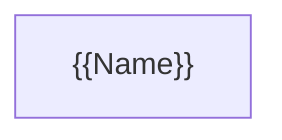

# {{Name}}'s modules and how they depend on each other

The kit's rule ARC-013 (`docs/standards/architecture.md`) asks for a diagram of the app's modules and the dependencies between them, here, and `./.kit/tools/Test-ArchitectureDiagram.ps1` checks in CI that it's there. Update it in the same pull request as any change that adds a module or project, or a dependency between them. Each arrow is a project reference, or a call between modules through their Contracts (ARC-002).

